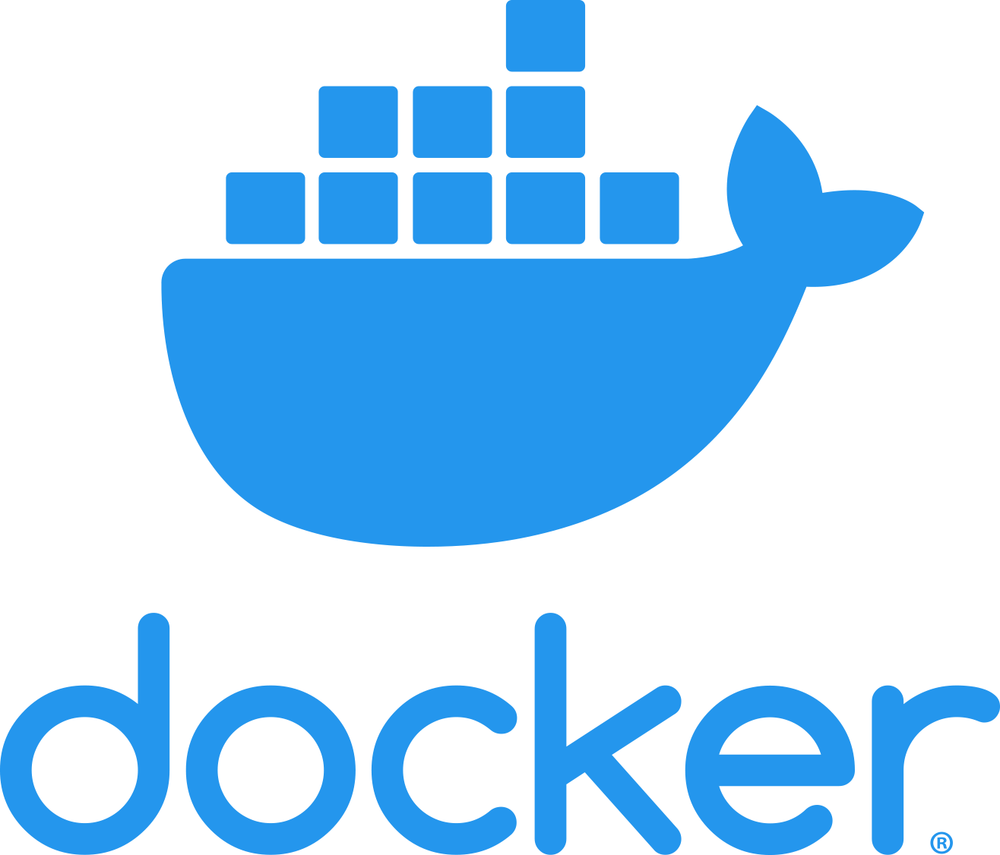

## What is [Docker]{.green}?

::: {.incremental}
- Standardized packaging for software, dependencies as well as the operating
  system
- Docker lets you create and run applications securely isolated in
  [containers]{.green}
:::

## Docker in life science

Docker can also be used to define software environments and settings for
benchmarking studies:

<br>

[CAMI Challenge](https://data.cami-challenge.org/): an independent evaluation of
several tools in the field of metagenomics.

> [...] We defined standards for submitting the software itself, along with
> parameter settings and required databases and implemented them in Docker
> container templates ... ^[_Sczyrba et al. Nature Methods (2017) 14:1063–1071,
> [doi.org/10.1038/nmeth.4458](https://doi.org/10.1038/nmeth.4458)_]

## Docker in life science

Docker can also be used to define software environments and settings for
benchmarking studies:

<br>

[2nd CAMI Challenge](https://cami-challenge.org/)

> For reproducibility, participants could submit a Docker container containing
> the complete workflow, a Bioconda script or a software repository with
> detailed installation instructions [...] ^[_Meyer et al. Nature Methods (2022)
> 19:429-440, [https://doi.org/10.1038/s41592-022-01431-4](https://doi.org/10.1038/s41592-022-01431-4)_]

## Docker nomenclature

::: {.fragment}
```{mermaid}
flowchart LR
    hub@{ shape: cloud, label: "Docker Hub<br><code>ubuntu:24.04</code>" }
    subgraph local [Local machine]
        img["Local image<br><code>ubuntu:24.04</code>"]
    end
    c1[Container]
    c2[Container]
    c3[Container]
    hub -. "docker pull" .-> img
    img -. "docker run" .-> c1 & c2 & c3
```
:::

::: {.incremental}
- A Docker [image]{.green} is a stand-alone executable package of software
- A Docker [container]{.green} is an instance of a Docker image
- A [Dockerfile]{.green} is a recipe used to build a Docker image
- [Docker Hub]{.green} is an online service for hosting Docker images
:::

## An example: using a different OS

::: {.fragment}
Check OS on local machine
```{.bash code-line-numbers="|1|2"}
$ uname -a
Darwin johnsmbp.local 27.0.0 Darwin Kernel Version 27.0.0: [...] arm64
```
:::

::: {.fragment}
Pull Ubuntu (Linux) image
```{.bash code-line-numbers="|1|2-6"}
$ docker pull ubuntu:24.04
24.04: Pulling from library/ubuntu
00dbf11534ae: Pull complete
...
Digest: sha256:68ee22004a9109b44973313b02ff7b1de250f1de0f5ecb628d73f579aaff33ac
Status: Downloaded newer image for ubuntu:24.04
```
:::

## An example: using a different OS

Check OS on local machine
```{.bash}
$ uname -a
Darwin johnsmbp.local 27.0.0 Darwin Kernel Version 27.0.0: [...] arm64
```

Run the container interactively and check OS version
```{.bash code-line-numbers="|1|2|3"}
$ docker run -it ubuntu:24.04
root@26aba7b7753c:/# uname -a
Linux 26aba7b7753c 7.0.14-linuxkit [...] aarch64 GNU/Linux
```

## Mounting volumes

:::: {.columns height=90%}

::: {.column}
::: {.fragment}
Local `project/` directory:
```{.bash code-line-numbers="1|2-11|3"}
$ ls
├── doc/
├── data/
├── code/
├── logs/
├── results/
├── Snakefile
├── config.yml
├── environment.yml
├── Dockerfile
└── README.md
```
:::
:::

::: {.column}
::: {.fragment}
Docker container file system:
```{.bash code-line-numbers="1-4|6-13|9-10"}
$ docker run \
    -v $PWD/data:/home/data \
    ubuntu:24.04 \
    ls

├── bin/
├── dev/
├── etc/
├── home/
│   └── data/
├── lib/
├── sys/
└── usr/
```
:::
:::

::::

## What can I use Docker for?

::: {.incremental}
1. As an advanced [environment]{.green} manager
2. To package your [code]{.green} together with the environment it needs
3. To package a [whole project]{.green} with environment, code _and_ data
:::

<br>

::: {.fragment}
Alternatives (2) and (3) are generally not advisable; containers are best used
to [control the environment]{.green} for maximal reproducibility, portability
and ease-of-use.
:::

<br>

::: {.fragment}
The best overall solution is a Git repository storing documentation, code,
environment specification as well as instructions on how to get the raw data.
:::

## What is Apptainer? {.nostretch}

{fig-align=center width=80%}

::: {.incremental}
- Another software for working with containers, similar to Docker
- An apptainer image is contained in a single file, facilitating portability
- Does not require `root` access, making it suitable for work at HPCs
:::

## What is Apptainer? {.nostretch}

{fig-align=center width=80%}

::: {.incremental}
- Apptainer used to be called 'Singularity'.
- In 2021 the open-source Singularity project joined the Linux Foundation and
  became [Apptainer]{.green}.
- The company [Sylabs]{.green} forked it as [SingularityCE]{.green} (open
  source) and SingularityPRO (commercial).
- In October 2026 Sylabs discontinued all its Singularity products;
  SingularityCE 4.6 is the final release.
- [Apptainer]{.green} is the actively maintained version, and still provides
  the `singularity` command and runs the same SIF images.
:::

## Docker vs. Apptainer

| {height=150 fig-align=center} | {height=150 fig-align=center} |
| --------------------------------------------------------- | --------------------------------------------------------------------------------------- |
| Runs as a daemon process with superuser privileges        | Runs as a regular user                                                                  |
| Images stored centrally                                   | Image files that you can move around                                                    |
| Isolates the host and container file system by default    | Containers have access to host file system                                              |
| Well-supported on Mac, Linux and Windows                  | Limited support on Mac and Windows                                                      |

# Questions?
