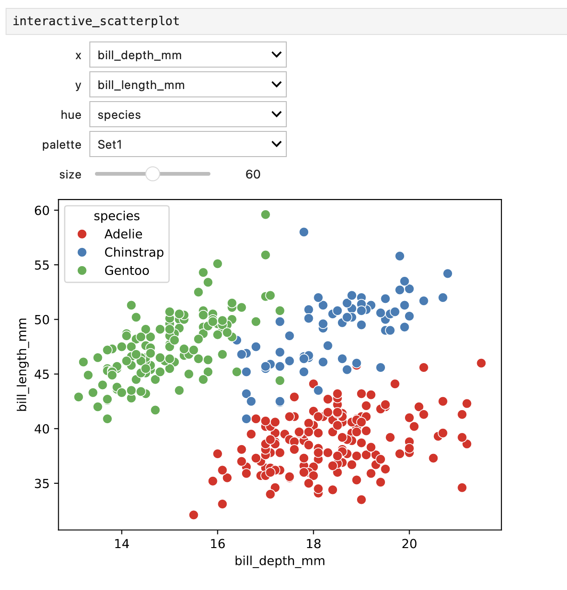

## Introduction

The Jupyter Notebook is an open-source web application that allows you to create
and share documents that contain code, equations, visualizations and text. Its
functionality partly overlaps with Quarto (see the [tutorial](quarto.html)), in
that both use Markdown and code chunks to generate reports that integrate
results of computations with the code that generated them. Jupyter comes from
the Python community while Quarto was developed by Posit (who also created R
Markdown and RStudio), but you can use most common programming languages in
either. Some reasons to use Jupyter include:

- Jupyter lets you write and run code piece by piece and see the results
  immediately, which makes it very well suited for exploratory data analysis.
- An early ambition with Jupyter notebooks (and their predecessor IPython
  notebooks) was to be analogous to the lab notebook used in a wet lab. A
  notebook lets you document your day-to-day work and interweave results,
  ideas, and hypotheses with the code. From a reproducibility perspective, this
  is one of the main advantages.
- The Jupyter community is large and dynamic, and there are lots of tools for
  sharing, displaying, testing and interacting with notebooks.

In this tutorial you will:

1. Learn the basics of JupyterLab and notebooks by exploring a dataset on
   penguins: write Markdown, run code, make plots and build interactive widgets.
2. Switch to results from the MRSA case study and learn how to keep a notebook
   reproducible: version control it with Git, test it with `nbval`, and run it
   from the command line.
3. Turn your MRSA notebook into a polished report with Quarto.

This tutorial depends on files from the course GitHub repo. Take a look at the
[setup](../home_precourse.html) for instructions on how to set it up if you
haven't done so already. Then open up a terminal, go to
`workshop-reproducible-research/tutorials/jupyter` and activate your
`jupyter-env` Conda environment.

::: {.callout-note title="A note on nomenclature"}
- **Jupyter**: a project to develop open-source software, open standards, and
  services for interactive computing across dozens of programming
  languages. Lives at [jupyter.org](https://jupyter.org).
- **JupyterLab**: the web application that you use in this tutorial for
  creating and working with notebooks. It also includes a file browser,
  terminals, a text editor, tabs _etc._ You start it with the command
  `jupyter lab`.
- **Jupyter Notebook**: the older, simpler web application for working with
  notebooks.
- **Notebook**: the actual `.ipynb` file that contains your code, text and
  results.
- **Kernel**: the process that runs the code in a notebook, in this tutorial a
  Python process from your `jupyter-env` Conda environment.
:::

## Starting JupyterLab

One thing that sets Jupyter apart from what you might be used to is that it's a
web application, _i.e._ you edit and run your code from your browser. But first
you have to start the Jupyter server. Do this by running:

```bash
jupyter lab
```

You should see something similar to this printed to your terminal:

```no-highlight
[I 2026-10-15 10:36:57.235 ServerApp] Serving notebooks from local directory: /Users/john/workshop-reproducible-research/tutorials/jupyter
[I 2026-10-15 10:36:57.235 ServerApp] Jupyter Server 2.17.0 is running at:
[I 2026-10-15 10:36:57.235 ServerApp] http://localhost:8888/lab?token=67d9cc21cd975e6a1ab86e39e44f4a7533e44e6d6d52c12a
[I 2026-10-15 10:36:57.235 ServerApp]     http://127.0.0.1:8888/lab?token=67d9cc21cd975e6a1ab86e39e44f4a7533e44e6d6d52c12a
[I 2026-10-15 10:36:57.235 ServerApp] Use Control-C to stop this server and shut down all kernels (twice to skip confirmation).
[C 2026-10-15 10:36:57.237 ServerApp]

    To access the server, open this file in a browser:
        file:///Users/john/Library/Jupyter/runtime/jpserver-72442-open.html
    Or copy and paste one of these URLs:
        http://localhost:8888/lab?token=67d9cc21cd975e6a1ab86e39e44f4a7533e44e6d6d52c12a
        http://127.0.0.1:8888/lab?token=67d9cc21cd975e6a1ab86e39e44f4a7533e44e6d6d52c12a
```

JupyterLab probably opened a web browser for you automatically. Otherwise, copy
one of the URLs under `Or copy and paste one of these URLs:` into your browser.

::: {.callout-tip title="A note for Windows users"}
When running in WSL, JupyterLab may not be able to open a browser for you. In
that case, start JupyterLab with `jupyter lab --no-browser` and copy one of the
URLs into the browser on your Windows computer.
:::

::: {.callout-note title="GitHub Codespaces"}

If you're running the workshop through GitHub Codespaces, then you can open
JupyterLab by holding the `Ctrl`-key (`Cmd`-key on Mac) and clicking the
`http://localhost:8888/lab` link under where it says `Jupyter Server <version>
is running at:`.

:::

What you're looking at is the JupyterLab interface, which should look something
like this:

> { width=700px }

In the left sidebar you have a few icons, the first being a folder icon. This
is the **File Browser**, which shows the files in your directory. The next icon
is **Running Terminals and Kernels**, which shows you the running kernels. The
third icon is the **Table of Contents**, which shows the outline of your active
notebook (if you have one open). This table will be populated with headers from
your Markdown cells. The fourth icon is the **Extension Manager**, where you can
install and manage extensions.

The main part of the interface is occupied by the **main work area**. This is
where you open and work on notebooks, text files, terminals and so on. These
are opened in tabs, and you can have several tabs open at the same time. Tabs
can be moved, resized, and split by dragging them around.

## Your first notebook

Let's create an empty notebook. In the **Launcher** tab, click the
`jupyter-env` tile under _Notebook_. If the Launcher isn't open, select
**File** > **New** > **Notebook** and choose the `jupyter-env` kernel in the
dialog that appears.

::: {.callout-note title="Why the `jupyter-env` kernel?"}
You may also see a kernel called "Python 3 (ipykernel)". Since you started
JupyterLab from the activated `jupyter-env` environment, both run the same
Python. We use `jupyter-env` because that name is stored in the notebook and
later lets command-line tools such as `nbconvert` and Quarto find the right
environment, no matter which environment is active.

If you also see kernels named like `Python [conda env:jupyter-env]`, these were
created by the `nb_conda_kernels` package, for example by an older version of
the `jupyter-env` environment. Choose the `jupyter-env` kernel anyway.
:::

Give your notebook a name by right-clicking on the text "Untitled.ipynb" at the
top of the tab and selecting "Rename Notebook". Enter `jupyter-tutorial.ipynb`.

Notebooks are made up of cells, and you should have one cell in your newly
created notebook. Clicking inside a cell puts you in **Edit mode**, which means
that you can type text in the cell. Pressing the `Esc` key puts you in
**Command mode**, which allows you to manipulate the notebook as a whole, more
on this below.

Cells in notebooks can be of two main types: _Markdown_ or _code_.

**Markdown cells** contain static material such as captions, text, lists,
images and so on. You express this using Markdown, which is a lightweight markup
language. The format is discussed in more detail in the [Markdown
introduction](markdown.html). JupyterLab uses a dialect of Markdown similar to
GitHub Flavored Markdown, which is described [at
GitHub](https://docs.github.com/en/get-started/writing-on-github/getting-started-with-writing-and-formatting-on-github/basic-writing-and-formatting-syntax).

**Code cells** are the cells that actually do something, just as code chunks do
in Quarto. When you run a code cell, the code is sent to the _kernel_ (in this
case the Python in your `jupyter-env` Conda environment), and any output the
code generates, such as text or figures, is displayed beneath the cell.

Here are some keyboard shortcuts that are useful when working with notebooks.
Most of them are also available from the menus, and you can see all of them by
opening the command palette (`ctrl-shift-c`, `cmd-shift-c` on Mac).

| Shortcut      | Mode    | Effect                                   |
|---------------|---------|------------------------------------------|
| `enter`       | Command | Enter Edit mode                          |
| `esc`         | Edit    | Enter Command mode                       |
| `ctrl-enter`  | Both    | Run the cell                             |
| `shift-enter` | Both    | Run the cell and select the cell below   |
| `alt-enter`   | Both    | Run the cell and insert a new cell below |
| `m`           | Command | Change cell to Markdown                  |
| `y`           | Command | Change cell to code                      |
| `a`           | Command | Insert cell above current cell           |
| `b`           | Command | Insert cell below current cell           |
| `d`, `d`      | Command | Delete cell                              |
| `z`           | Command | Undo cell operation                      |
| `x`           | Command | Cut selected cells                       |
| `v`           | Command | Paste cells below                        |
| `0`, `0`      | Command | Restart the kernel                       |

On Mac, you can use `cmd` instead of `ctrl` for these shortcuts.

## Writing Markdown

A good notebook reads like a lab notebook: it says what you set out to do, what
you did and what you found. Let's start by writing an introduction to the
analysis we're about to do.

Your notebook has one empty cell, probably in Edit mode. Press `Esc` to enter
Command mode, then press `m` to change the cell to Markdown. Click inside the
cell (or press `enter`) and add the following:

```markdown
# Exploring the Palmer penguins

In this notebook I explore measurements of **three penguin species**
collected at the [Palmer Station](https://pallter.marine.rutgers.edu/),
Antarctica.

## Questions

1. Do penguins on different islands differ in body mass?
2. How are *bill length* and *bill depth* related?

---

> Note to self: check for missing values before plotting!
```

Run the cell with `ctrl-enter`. The cell is now rendered: headers, a link, bold
and italic text, a numbered list, a horizontal line and a blockquote.
Double-click the cell to edit it again.

Markdown cells can also contain equations written in LaTeX. Add a new Markdown
cell (press `b` in Command mode, then `m`) with this content and run it:

```markdown
Later on I may compute a crude bill size as $\text{length} \times \text{depth}$,
and the Pearson correlation between bill length and depth:

$$
r = \frac{\sum_i (x_i - \bar{x})(y_i - \bar{y})}
{\sqrt{\sum_i (x_i - \bar{x})^2 \sum_i (y_i - \bar{y})^2}}
$$
```

::: {.callout-tip title="Your turn"}
Add a short "Methods" section to your notebook in a new Markdown cell. Include
at least one inline code snippet (using backticks, _e.g._ `` `seaborn` ``) and a
bulleted list. See the [Markdown introduction](markdown.html) if you need a
reminder of the syntax.
:::

## Writing code

Now let's write some code! Create a new cell below your Markdown cells by
pressing `b` in Command mode, or by clicking the `+` in the notebook toolbar.
New cells are code cells by default. Since we chose a Python kernel, the code
is run as Python. Enter this code in the cell and run it:

```python
print("Hello world!")
```

Note how the output is displayed directly below the cell, and that a number
appears in brackets to the left of the cell, _e.g._ `[1]`. This is the
**execution count**: it tells you in which order the cells have been run.

Variables and functions defined in one cell are available in all other cells,
since they all live in the same kernel. This is very handy, but it also means
that the result of a cell depends on what has been run before it, and not on
what is written above it. Let's see what that means in practice.

Add a cell with the following code and run it:

```python
penguin_count = 10
```

Then add a new cell below it and run it:

```python
penguin_count * 2
```

You should get `20`. Now go back to the first of the two cells, change it to
`penguin_count = 100`, but **don't** run it. Run the second cell again. What do
you get, and why?

Now run the first cell, and then the second cell again. Look at the execution
counts to the left of the cells: they no longer increase from top to bottom.

Finally, delete the first cell (select it, then press `d`, `d` in Command mode)
and run the second cell again. It still works! The variable `penguin_count`
still exists in the kernel, even though the code defining it is gone. If you
shared this notebook with a colleague, it would fail on their computer.

To find this kind of problem, select **Kernel** > **Restart Kernel and Run All
Cells...** from the menu. This starts a fresh kernel and runs all cells from
top to bottom, just as someone opening your notebook for the first time would.
You should now get a `NameError` for `penguin_count`.

::: {.callout-important title="Hidden state"}
The values stored in the kernel that no longer match the code in the notebook
are often called _hidden state_. This is the biggest difference between working
in a notebook and rendering a Quarto document, which always runs all code from
top to bottom in a fresh session. Make it a habit to run **Restart Kernel and
Run All Cells** before you save or share a notebook. We will come back to tools
that help with this in the [reproducibility](#reproducibility) section.
:::

Delete the cell with `penguin_count * 2` before moving on.

What **is** a notebook file, actually? Let's look at the notebook we're
currently working in. JupyterLab autosaves your notebook every couple of
minutes, but save it now with `ctrl-s` (`cmd-s` on Mac) to be sure. We can be a
little meta and look at the file from within the notebook itself, by running
shell commands in a code cell. You do this by prepending the command with `!`.
Add `!ls` to a code cell and run it. This lists the files in the current
directory.

Aha, there's a file called `jupyter-tutorial.ipynb`! This is our notebook. Look
at the first ten lines of the file by running `!head jupyter-tutorial.ipynb`.
It's a plain old JSON text file. Since it's a text file, it's suitable for
version control with _e.g._ Git. There are however some special considerations
to take into account for notebooks, which we will cover in the [reproducibility
section](#reproducibility) of this tutorial.

The focus of this tutorial is not on how to write Markdown or Python; you can
make really pretty notebooks with Markdown and you can code whatever you want
with Python. Rather, we will focus on the Jupyter features that allow you to do
a little more than that.

::: {.callout-note title="Quick recap"}
In this section we've learned:

- How to start JupyterLab and create a notebook.
- That a notebook consists of Markdown cells and code cells.
- That code is run by a kernel, which remembers everything that has been run,
  in the order it was run.
- How to avoid hidden state with **Restart Kernel and Run All Cells**.
- How to run shell commands by prepending them with `!`.
- That a notebook is a text file in JSON format.
:::

## Magics

Magics are special commands that extend the power of notebooks. There are two
types of magics:

- **Line magics**: commands that start with `%`, and whose arguments only extend
  to the end of the line.
- **Cell magics**: commands that start with `%%` and apply to the whole cell.
  They must be written on the first line of a cell.

List all available magics by adding `%lsmagic` (which itself is a magic) to a
cell and running it. You can add a question mark to a magic to show its help
(_e.g._ `%lsmagic?`). Some magics act as shortcuts for commonly used shell
commands (`%ls`, `%cp`, `%cat`, ...). Others are useful for debugging and
optimizing your code (`%timeit`, `%debug`, `%prun`, ...). For more information
see the [magics
documentation](https://ipython.readthedocs.io/en/stable/interactive/magics.html).

### Timing code

A very useful magic is `%timeit`, which runs a line of code many times and
reports how long it takes on average. Let's use it to compare two ways of
summing the squares of one million numbers. First, create the numbers:

```python
import numpy as np
numbers = np.arange(1_000_000)
```

Then time a plain Python loop (written as a generator expression) in one cell:

```python
%timeit sum(n**2 for n in numbers)
```

and the NumPy equivalent in another:

```python
%timeit np.sum(numbers**2)
```

How much faster is NumPy on your computer? Use the cell magic `%%timeit` if you
want to time all the code in a cell rather than a single line.

### Other languages

Some cell magics let you run code in other languages than Python, for
example:

- `%%bash` runs the cell as a Bash script.
- `%%perl` and `%%ruby` run the cell with Perl and Ruby (if installed).
- `%%R` runs the cell as R code (requires the `rpy2` package, see below).
- `%%script <program>` runs the cell with any program, similar to a shebang.

Other cell magics display the content of the cell in a special format, for
example `%%html`, `%%markdown` and `%%latex`.

::: {.callout-note title="A note on R code"}
In order to use the `%%R` magic you need the `rpy2` package, which is already
installed in the `jupyter-env` environment you're using for this tutorial.
However, you first have to load it by running `%load_ext rpy2.ipython` in a
cell.
:::

Try this out if you know any of these languages. For example, to run some
simple R code:

```r
%%R
print(paste("Hello", "world", sep = " "))
```

Or to display the quadratic formula with LaTeX:

```latex
%%latex
$$x = \frac{-b \pm \sqrt{b^2 - 4ac}}{2a} \quad \text{when} \quad ax^2 + bx + c = 0$$
```

::: {.callout-tip title="Capturing output" collapse="true"}
The `%%capture` cell magic captures the stdout/stderr of a cell and stores them
in a Python object. This can be useful when running shell commands that produce
a lot of output. For example:

```no-highlight
%%capture output
%%bash
echo "Print to stdout"
echo "Print to stderr" >&2
```

... and in another cell:

```python
print("stdout: " + output.stdout)
print("stderr: " + output.stderr)
```

You can also capture the output of some line magics directly, like this:
`my_dir = %pwd`.
:::

::: {.callout-note title="Quick recap"}
In this section we've learned:

- The difference between line magics and cell magics.
- How to time code with `%timeit`.
- How to use magics to run non-Python code in notebooks.
:::

## Plotting

An essential feature of notebooks is the ability to visualize data and results
in plots, right next to the code that made them. A full guide to plotting in
Python is beyond the scope of this course, but we will offer a few glimpses into
the plotting landscape of Python.

Python has a library for plotting called
[Matplotlib](https://matplotlib.org/stable/index.html), which comes packed with
functionality for creating high-quality plots. Below is an example of how to
generate a line plot of a sine wave.

```python
# Import packages
import numpy as np
import matplotlib.pyplot as plt
# Generate 100 evenly spaced numbers between 0 and 3π
x = np.linspace(0, 3 * np.pi, 100)
# Use the sine function to generate y-values
y = np.sin(x)
# Plot the data
plt.plot(x, y, color="red", linestyle="-")
```

By default, plots are shown in the notebook as rasterized PNG images, which can
look a little blurry. To render plots in the scalable vector graphics (SVG)
format instead, add the following to a cell and run it:

```python
import matplotlib_inline
matplotlib_inline.backend_inline.set_matplotlib_formats("svg")
```

Now run the code for the sine wave plot again.

### Exploring data with Seaborn

Matplotlib comes with **a lot** of functionality, which is great because it
allows you to create all sorts of plots and modify them exactly to your liking.
However, this can also mean that creating very basic plots involves a lot of
cumbersome coding, when all you want is a simple bar chart!

Fortunately there are a number of Python packages that build upon Matplotlib
but with a much simplified interface. One such popular package is
[Seaborn](https://seaborn.pydata.org/). Let's use it to answer the questions we
wrote in the introduction of our notebook.

First import the Seaborn package (using an abbreviated name to simplify typing):

```python
import seaborn as sns
```

Next, load the penguin data. This is one of the example datasets that come with
Seaborn and contains measurements of penguins from three islands near the
Palmer Station in Antarctica.

```python
penguins = sns.load_dataset("penguins")
# Look at the first 5 rows of the data
penguins.head(5)
```

::: {.callout-note}
`sns.load_dataset` downloads the data from the internet the first time you run
it, so you need to be online for this step.
:::

The most basic way to generate a bar plot of this data with Seaborn is:

```python
sns.barplot(data=penguins)
```

Simple, right? Yes, but not very informative. Here Seaborn calculates the mean
of each numeric column and plots them with error bars representing a 95%
confidence interval. Since body mass (in grams) is so much larger than the other
measurements, it's hard to see anything else.

Let's address our first question instead, and plot the mean body mass of the
penguins on each island:

```python
sns.barplot(data=penguins, x="island", y="body_mass_g", errorbar="sd")
```

Here we specified that the values in the `island` column should be used as
categories on the x-axis, and the values in the `body_mass_g` column as values
on the y-axis. The `barplot` function then calculates the mean body mass for
each island and plots the bars. With `errorbar="sd"` we tell the function to
draw the standard deviation as error bars, instead of a confidence interval.

It looks like the penguins on Biscoe are a lot heavier than those on Dream and
Torgersen. Is there something special about Biscoe? Before reading on, think of
another column in the data that could explain this difference.

Let's color the bars by species:

```python
sns.barplot(data=penguins, x="island", y="body_mass_g", hue="species",
            errorbar="sd")
```

The difference is mostly explained by species: Biscoe is the only island with
Gentoo penguins, which are much heavier than the other two species. Adelie
penguins, found on all three islands, weigh about the same everywhere.

Now to our second question: how are bill length and bill depth related? Seaborn
can plot the data points together with a fitted regression line using
`sns.lmplot`:

```python
sns.lmplot(data=penguins, x="bill_length_mm", y="bill_depth_mm")
```

It seems that penguins with longer bills have shallower bills. But let's again
color the data by species:

```python
sns.lmplot(data=penguins, x="bill_length_mm", y="bill_depth_mm", hue="species")
```

Within each species, the relationship is the opposite: penguins with longer
bills have **deeper** bills! The negative trend in the first plot is caused by
the differences between species. This phenomenon is called [Simpson's
paradox](https://en.wikipedia.org/wiki/Simpson%27s_paradox), and is a good
example of why it's worth exploring your data interactively before drawing any
conclusions. Write down what you found in a Markdown cell in your notebook.

### Modifying and saving plots

Seaborn plots can be modified with Matplotlib functions. Let's make a
scatterplot of body mass against bill length, color the points by species, move
the legend outside of the plot and change the axis labels:

```python
# Store the Matplotlib axes containing the plot in a variable called 'ax'
ax = sns.scatterplot(data=penguins, x="bill_length_mm", y="body_mass_g",
                     hue="species")
# Modify the labels of the plot
ax.set_xlabel("Bill length (mm)")
ax.set_ylabel("Body mass (g)")
# Place the upper left corner of the legend at the upper right corner of the plot
ax.legend(loc="upper left", bbox_to_anchor=(1, 1))
```

If you want to save a plot to a file you can use the `plt.savefig` function. Add
the following to the bottom of the cell with the scatterplot code and run it:

```python
plt.savefig("scatterplot.pdf", bbox_inches="tight")
```

The `bbox_inches="tight"` setting ensures that the figure (including the
legend) is not clipped when saved to file.

::: {.callout-tip title="Your turn"}
Make a histogram of flipper lengths with `sns.histplot`, colored by species.
Look at the [Seaborn documentation](https://seaborn.pydata.org/generated/seaborn.histplot.html)
to find out how to set the number of bins.
:::

::: {.callout-tip title="Solution" collapse="true"}
```python
sns.histplot(data=penguins, x="flipper_length_mm", hue="species", bins=30)
```
:::

The Seaborn [website](https://seaborn.pydata.org/) contains great tutorials and
examples of other ways to plot data!

::: {.callout-note title="Quick recap"}
In this section we've learned:

- How to generate simple plots with Matplotlib.
- How to use Seaborn to explore a dataset.
- How to save plots from notebooks to a file.
:::

## Widgets

Since we're running our notebooks in a web browser, they are well suited for
including interactive elements. A typical use case is that you want to explore
how some setting affects a plot, or that you want collaborators to be able to
change how results are displayed, _e.g._ to select which gene to plot or to see
how a parameter value affects a clustering. Notebooks have great support for
this in the form of _widgets_.

Widgets are Python objects that are shown in the browser as controls such as
sliders, drop-down menus or text boxes. When you change the control, Python
code is run in the kernel. Widgets are implemented in the `ipywidgets` package.

### Your first widget

The easiest way to get started is the `interact` function. It takes a function
that you define and generates widgets for each of its arguments. When you
change a widget, the function is called with the new value. Add this to a cell
and run it:

```python
from ipywidgets import interact

@interact(bins=(5, 50, 5))
def flipper_histogram(bins=20):
    sns.histplot(data=penguins, x="flipper_length_mm", hue="species", bins=bins)
```

The `@interact(...)` line above the function is a _decorator_: it hands the
function over to `interact`, which displays a slider for `bins` right away.
The tuple `(5, 50, 5)` sets the minimum value of the slider to 5, the maximum
to 50 and the step size to 5. Move the slider and watch the histogram update.

The type of value you give for an argument decides which widget is created:

- a tuple of numbers, _e.g._ `(5, 50, 5)`, creates a slider
- a list of options, _e.g._ `["species", "island", "sex"]`, creates a drop-down
- `True` or `False` creates a checkbox
- a string creates a text box

::: {.callout-tip title="Your turn"}
Add a `hue` argument to `flipper_histogram` with a drop-down to choose between
coloring by `species`, `island` or `sex`.
:::

::: {.callout-tip title="Solution" collapse="true"}
```python
@interact(bins=(5, 50, 5), hue=["species", "island", "sex"])
def flipper_histogram(bins=20, hue="species"):
    sns.histplot(data=penguins, x="flipper_length_mm", hue=hue, bins=bins)
```
:::

### An interactive scatterplot

Let's take the scatterplot of the penguins from the previous section and add
widgets that let us choose which variables to plot as well as the coloring of
the points. This time we'll use the `interactive` function, which works like
`interact` but returns the widget so that we can store it in a variable and
display it whenever we want.

First import the `interactive` function and the `widgets` module, which we'll
use later:

```python
from ipywidgets import interactive, widgets
```

Now, in a new cell, define a function called `scatterplot` with the code to
generate the plot itself. We also add a `palette` argument to the function so
that we can choose the color palette of the plot:

```python
def scatterplot(x, y, hue, palette):
    sns.scatterplot(data=penguins, x=x, y=y, hue=hue, palette=palette)
```

Run the cell and create a new cell below it.

Next, we'll use the `interactive` function to generate widgets for the `x`,
`y`, `hue` and `palette` arguments. The `interactive` function takes a function
as its first argument, followed by keyword arguments for each of the arguments
of that function. We store the returned widget in a variable called
`interactive_scatterplot`. Add the following to a cell and run it:

```python
interactive_scatterplot = interactive(
    scatterplot,
    x=["bill_length_mm", "bill_depth_mm", "flipper_length_mm", "body_mass_g"],
    y=["body_mass_g", "bill_length_mm", "bill_depth_mm", "flipper_length_mm"],
    hue=["species", "island", "sex"],
    palette=["Set1", "Set2", "Dark2", "Paired"],
)
```

All arguments of the `scatterplot` function that don't have a default value
must be given in the `interactive` call. The `interactive_scatterplot` widget
is now tied to the `scatterplot` function, but we still haven't displayed it.
To do that, add `interactive_scatterplot` to a new cell and run it:

```python
interactive_scatterplot
```

This should show the scatterplot with drop-down menus for each of the
arguments. Try changing the `x` and `y` variables by selecting from the
drop-downs. The `hue` drop-down lets you change which variable to use for
coloring the points and the `palette` drop-down changes the color palette. The
available options are the ones we specified in the `interactive` call.

Let's add a slider to control the size of the points. In Seaborn's
`scatterplot` function, the point size is set with the `s` argument (which is
passed on to Matplotlib). Modify the cell with your `scatterplot` function so it
looks like this, and run it to update the function definition:

```python
def scatterplot(x, y, hue, palette, size=50):
    sns.scatterplot(data=penguins, x=x, y=y, hue=hue, palette=palette, s=size)
```

Setting `size=50` in the function definition means that the default size of the
points is 50. Now update the cell where we call the `interactive` function so
that it looks like this, then run it:

```python
interactive_scatterplot = interactive(
    scatterplot,
    x=["bill_length_mm", "bill_depth_mm", "flipper_length_mm", "body_mass_g"],
    y=["body_mass_g", "bill_length_mm", "bill_depth_mm", "flipper_length_mm"],
    hue=["species", "island", "sex"],
    palette=["Set1", "Set2", "Dark2", "Paired"],
    size=(20, 100, 10),
)
```

Finally, re-run the cell where we display `interactive_scatterplot`. You should
now see a slider for the `size` argument, starting at 50. Try changing the size
of the points by moving the slider.

This is how it should look if everything works:

{ width=700px }

### Other widgets

There are lots of other widgets, _e.g._:

- Toggle buttons
- Range sliders
- Date pickers
- File uploaders

... and much, much more. Here is a [list of all available
widgets](https://ipywidgets.readthedocs.io/en/latest/examples/Widget%20List.html)
together with documentation and examples. Some of these widgets cannot be
generated automatically by `interactive`, but fear not! Instead, we can create
the widget ourselves and give it directly to `interactive`.

To see this in practice, we'll make the scatterplot function display a title and
add a color picker widget to set the color of the title text. First, update the
scatterplot function so that it looks like this, and run the cell:

```python
def scatterplot(x, y, hue, palette, size=50, color="blue"):
    ax = sns.scatterplot(data=penguins, x=x, y=y, hue=hue, palette=palette, s=size)
    ax.set_title("Penguin scatterplot", color=color)
```

Next, we'll define the color picker widget. Add the definition to the cell
where you defined `interactive_scatterplot` and give the widget to the
`interactive` call. The cell should look like this:

```python
colorpicker = widgets.ColorPicker(description="Title color", value="blue")
interactive_scatterplot = interactive(
    scatterplot,
    x=["bill_length_mm", "bill_depth_mm", "flipper_length_mm", "body_mass_g"],
    y=["body_mass_g", "bill_length_mm", "bill_depth_mm", "flipper_length_mm"],
    hue=["species", "island", "sex"],
    palette=["Set1", "Set2", "Dark2", "Paired"],
    size=(20, 100, 10),
    color=colorpicker,
)
```

Run the cell, then re-run the cell where we display `interactive_scatterplot`.
The plot should now have a title, and you should see a color picker below the
slider for the point size. Try changing the title color with the color picker.

::: {.callout-note}
You may have to close the color picker once you've made your choice in order to
make the plot update.
:::

::: {.callout-important title="Widgets need a running kernel"}
Widgets work by running Python code in the kernel every time you change them.
This means that they don't work when a notebook is exported to a static format
such as HTML or PDF, which we'll do later in this tutorial. If you need
interactive plots in a static HTML report, look at the libraries below.
:::

::: {.callout-tip title="Other interactive plotting libraries" collapse="true"}
- [Altair](https://altair-viz.github.io/) is a plotting library based on the
  Vega-Lite grammar of graphics, reminiscent of ggplot2 in R. Its plots stay
  interactive (zoom, tooltips, selections) even in exported HTML. Altair is
  installed in `jupyter-env` if you want to try it.
- [Plotly](https://plotly.com/python/) generates very visually appealing
  interactive graphs that also work in exported HTML.
- [Bokeh](https://docs.bokeh.org/en/latest/) is another popular library for
  interactive graphs, well suited for dashboards and large datasets.
:::

::: {.callout-note title="Quick recap"}
In this section we've learned:

- How to quickly make interactive plots with `interact`.
- How to build and display widgets with `interactive`.
- How to create a widget yourself and give it to `interactive`.
:::

## Extensions

JupyterLab extensions are add-ons that increase the functionality of JupyterLab.
Extensions include themes, editors, Git support, renderers and much more. The
most user-friendly way of managing extensions is via the Extension Manager,
which you open by clicking the puzzle piece icon in the left sidebar. You can
search for available extensions in the search field, then click "Install" to
install an extension.

::: {.callout-caution}
The Extension Manager contains a disclaimer warning you that third-party
extensions are not reviewed for vulnerabilities, so be careful about which
extensions you install. Also note that the Extension Manager installs extensions
with `pip` into your active Conda environment. For a reproducible setup, it's
better to add the extensions you need to your Conda environment file.
:::

Some extensions that are of particular relevance to this course:

- [jupyterlab-quarto](https://github.com/quarto-dev/jupyterlab-quarto) - render
  Quarto-specific Markdown (such as callouts) in notebooks
- [jupyterlab-git](https://github.com/jupyterlab/jupyterlab-git) - version
  control with Git from within JupyterLab
- [nbdime](https://nbdime.readthedocs.io/en/latest/) - view differences between
  versions of a notebook (already installed in `jupyter-env`, more on this
  below)

::: {.callout-note title="Quick recap"}
In this section we've learned:

- What JupyterLab extensions are and how to manage them.
:::

## Reproducibility

Now that you have a feeling for what Jupyter can do, it's time to put it to work
on real data. As in the Snakemake and Nextflow tutorials, we will use the MRSA
case study. The `results/` directory contains output from a run of the MRSA
workflow:

- `results/tables/counts.tsv`: read counts per gene and sample from
  `featureCounts`
- `results/tables/counts.tsv.summary`: a summary of how many reads were
  assigned to genes in each sample
- `results/multiqc/multiqc_general_stats.txt`: quality control statistics from
  MultiQC
- `results/rulegraph.png`: the rule graph of the workflow

A very common use of notebooks is to explore and summarize the results of a
workflow like this. In this part of the tutorial we will start such an analysis
and look at what you need to think about from a reproducibility point of view.

### Version control of notebooks

As we've seen, notebooks are plain-text JSON files. This means that they can be
version controlled with Git just like any other text file. However, because of
the way notebooks store their content, the diffs produced by Git can be
difficult to interpret. Luckily, there are tools that provide content-aware
diffs and merge functionality for notebooks.

One such tool is [nbdime](https://nbdime.readthedocs.io/en/latest/). nbdime
understands the structure of notebooks and can therefore generate diffs that
are easier to read. It can also be used to merge changes made to notebooks,
which is especially useful when collaborating on notebooks with others.

nbdime is already installed in the `jupyter-env` Conda environment you are
using for this tutorial. To try it out, create a new notebook with the
`jupyter-env` kernel and name it `Analysis.ipynb`. Add the following code to the
first cell, then run it:

```python
import pandas as pd
counts = pd.read_csv(
    "results/tables/counts.tsv",
    sep="\t",
    comment="#",
    index_col=0
)
counts.head()
```

This imports the `pandas` package and reads the table of counts into a
_data frame_. The `comment="#"` argument skips the first line of the file,
which contains the command used to run `featureCounts`. Look at the output:
the sample columns have long names, such as `results/bam/SRR935090.sorted.bam`.

Save the notebook. Now add and commit the new notebook to the Git repository,
by running the following in a terminal (you can open one in JupyterLab from
**File** > **New** > **Terminal**):

```bash
git add Analysis.ipynb
git commit -m "Add Analysis notebook"
```

So far so good, and nothing new compared to what we've already learned about
version control. Now let's make some changes to the notebook. First we'll
shorten the sample names. Update the first cell of the notebook so that it
reads:

```python
import pandas as pd
counts = pd.read_csv(
    "results/tables/counts.tsv",
    sep="\t",
    comment="#",
    index_col=0
)
counts = counts.rename(columns=lambda x: x.split("/")[-1].replace(".sorted.bam", ""))
```

Then create a new cell where we calculate the total number of counts in each
sample:

```python
counts.loc[:, "SRR935090":"SRR935092"].sum()
```

Run both cells and save the notebook. Note that sample `SRR935091` has far
fewer counts than the other two samples. If you look at
`results/tables/counts.tsv.summary` you'll see that most of the reads in this
sample could not be mapped to the genome.

Now use `git diff` to view the changes we've made to the notebook. Run:

```bash
git diff Analysis.ipynb
```

Even with these minor modifications, the diff contains numerous lines that are
difficult to interpret. This is because the notebook not only contains the
code, but also cell metadata and output (in this case the tables produced by
the cells).

Now let's generate an easier-to-read diff. Run:

```bash
nbdiff -s Analysis.ipynb
```

This uses the `nbdiff` tool that comes with nbdime to show a diff of the
notebook compared to the last commit. The `-s` flag tells `nbdiff` to only show
differences in the source code of the cells, ignoring changes in metadata and
output. There are a number of flags you can use to customize the diff. The
uppercase version of each flag ignores the respective change type. For example,
to see the diff but ignore changes to the output of cells, run:

```bash
nbdiff -O Analysis.ipynb
```

nbdime also comes with a graphical web-based diff viewer. To try it, run:

```bash
nbdiff-web Analysis.ipynb
```

This opens a tab in your web browser showing the changes made to the notebook
side-by-side for each cell, including cell output. This makes it easy to see
changes made both to code and to outputs such as tables and plots.

::: {.callout-tip title="Other tools for version control of notebooks"}
- nbdime also comes with a JupyterLab extension, which is already installed in
  `jupyter-env`. Look for the diff buttons in the notebook toolbar. If you also
  install the [jupyterlab-git](https://github.com/jupyterlab/jupyterlab-git)
  extension you can both view diffs and commit changes directly from
  JupyterLab.
- [VS Code](https://code.visualstudio.com/) has built-in Git support, and with
  the [Jupyter
  extension](https://marketplace.visualstudio.com/items?itemName=ms-toolsai.jupyter)
  installed you can also work with notebooks and view [informative
  diffs](https://code.visualstudio.com/docs/datascience/jupyter-notebooks#_custom-notebook-diffing)
  directly in the editor.
:::

### Making sure notebooks work as expected

As we saw earlier, the kernel remembers variables and functions until you
restart it. This makes it easy to change your analysis and re-run cells to see
the effect immediately, but it is also a source of errors: if you change a cell
and forget to re-run the cells that depend on it, the outputs stored in the
notebook no longer match the code.

The [nbval](https://nbval.readthedocs.io/en/latest/) package can help you catch
these types of errors. nbval is a plugin for the `pytest` testing framework that
tests notebooks. It works by executing each cell in the notebook in a fresh
kernel and comparing the output to the output stored in the notebook. If the
output is the same, the test passes. If the output differs, the test fails.
nbval is also pre-installed in the `jupyter-env` Conda environment.

Let's continue with the `Analysis.ipynb` notebook. Add a new cell where we
select the count columns of our three samples:

```python
samples = ["SRR935090", "SRR935091", "SRR935092"]
expression = counts[samples]
```

Run the cell and add a new one below it, where we show the five genes with the
highest counts in sample `SRR935092`:

```python
expression.sort_values("SRR935092", ascending=False).head()
```

Run the cell to see the output. Now we have a very simple example of an
exploratory analysis of the MRSA results.

Save the notebook and run nbval on it to see if it works as expected. From the
command line, run:

```bash
pytest --nbval Analysis.ipynb
```

The output of the test should look something like this:

```no-highlight
collected 4 items

Analysis.ipynb ....                                                      [100%]

========== 4 passed in 1.32s ==========
```

Now let's say we realize that we should account for the different sequencing
depths of the samples (remember that `SRR935091` had far fewer counts). A
common way to do this is to normalize the counts to _counts per million_ (CPM),
_i.e._ divide the counts by the total number of counts in each sample and
multiply by one million. We'll just modify the cell where we defined
`expression`.

Change the third cell of the notebook so that it reads:

```python
samples = ["SRR935090", "SRR935091", "SRR935092"]
expression = counts[samples] / counts[samples].sum() * 1e6
```

Re-run **only this cell** and save the notebook. So far so good! Let's test the
notebook again with nbval. Just like before, run it from the command line with:

```bash
pytest --nbval Analysis.ipynb
```

If you've followed the instructions, this second run of nbval should generate a
`FAILED` test, showing something like:

```no-highlight
==================== short test summary info ====================
FAILED Analysis.ipynb::Cell 3 - Notebook cell execution failed
================== 1 failed, 3 passed in 1.25s ==================
```

What happened here was that we modified the cell where we defined `expression`,
but we didn't re-run the cell that shows the top genes. The output stored for
that cell still shows raw counts, while running the notebook from the top now
gives CPM values. This type of error can be difficult to spot, especially in a
large notebook with many cells. Luckily, nbval catches it for us.

::: {.callout-note}
nbval reports cell numbers using 0-based numbering, so `Cell 3` refers to the
4th cell in the notebook.
:::

This problem could have been avoided by running **Kernel** > **Restart Kernel
and Run All Cells...** before saving the notebook. Do that now, save the
notebook, and run nbval again to check that all tests pass.

::: {.callout-tip title="Your turn"}
Add a new cell at the bottom of the notebook that shows five random genes:

```python
expression.sample(5)
```

Restart the kernel, run all cells, save the notebook and run nbval. Why does the
test fail even though you just ran all cells? Give this some thought, then click
the solution below to see if you got it right.
:::

::: {.callout-tip title="Solution" collapse="true"}
`expression.sample(5)` picks different genes every time it runs, so the output
never matches the stored output.

nbval lets you skip the comparison of a cell's output by adding the comment
`# NBVAL_IGNORE_OUTPUT` on the first line of the cell. Use it to make the test
pass by changing the cell to:

```python
# NBVAL_IGNORE_OUTPUT
expression.sample(5)
```

nbval still runs the cell, it just doesn't compare its output. So if the code
itself breaks, for example with a `NameError` because `expression` is no longer
defined, the test still fails. Other examples of output that changes between
runs are timings (_e.g._ from `%timeit`) and dates.

:::

::: {.callout-tip title="Marimo - the future of Python notebooks?"}

While Jupyter is a very powerful tool, you may have noticed that there are
things that don't play nicely with some core aspects of reproducibility. For
example, the JSON format used for notebooks is a little heavy for version
control (especially when cell output is included), and hidden state can lead to
non-reproducible notebooks. [Marimo](https://docs.marimo.io/) is a newer tool
for Python notebooks that solves a lot of these issues by storing notebooks as
pure Python files and automatically re-running dependent cells when the code is
updated. Marimo is not yet part of this course, but feel free to try it out if
you like.

:::

::: {.callout-note title="Quick recap"}

In this section we've learned:

- How to use nbdime to view diffs of notebooks.
- How to use nbval to test that notebooks work as expected.
- How to make nbval ignore output that changes between runs.

:::

## Converting notebooks

Notebooks can be converted to various output formats such as HTML, PDF, LaTeX
_etc._ directly from the **File** > **Save and Export Notebook As...** menu.

Conversion can also be performed on the command line using the
`jupyter nbconvert` command. The syntax for converting a notebook is:

```bash
jupyter nbconvert --to <FORMAT> <NOTEBOOK>
```

Here `<NOTEBOOK>` is the filename of the notebook you want to convert and
`<FORMAT>` can be any of `asciidoc`, `custom`, `html`, `latex`, `markdown`,
`notebook`, `pdf`, `python`, `rst`, `script`, `slides` and `webpdf`.
Converting to some output formats requires additional software, _e.g._ a
**TeX** installation for `pdf`.

You can also specify a different output file with `--output <filename>`.

Try converting the `Analysis.ipynb` notebook to HTML. Click the solution below
if you need help.

::: {.callout-tip title="Solution" collapse="true"}
```bash
jupyter nbconvert --to html Analysis.ipynb
```
:::

Open `Analysis.html` in your browser to verify it looks ok.

We can also execute all cells of a notebook from the command line before
converting it, using the `--execute` flag:

```bash
jupyter nbconvert --execute --to <FORMAT> <NOTEBOOK>
```

This is a great way to make sure that the notebook runs from top to bottom
without hidden state, since a fresh kernel is used. When the notebook is
executed, nbconvert uses the kernel stored in the notebook metadata, _i.e._ the
kernel you selected when you created the notebook. If you want to use a
different kernel, you can specify it with
`--ExecutePreprocessor.kernel_name=<KERNEL_NAME>`. To see the available kernels,
run `jupyter kernelspec list`.

Let's execute and convert `Analysis.ipynb` to an HTML file called
`report.html`. The `jupyter-env` kernel is already associated with the notebook,
but let's be explicit and specify it anyway. Run the following command:

```bash
jupyter nbconvert --execute --to html --output report.html \
  --ExecutePreprocessor.kernel_name=jupyter-env Analysis.ipynb
```

::: {.callout-tip}
By default, `nbconvert --execute` stops at the first cell that raises an error.
Add the `--allow-errors` flag if you want to convert the notebook anyway, with
the error messages included in the output.
:::

::: {.callout-note title="Quick recap"}
In this section we've learned:

- How to convert notebooks to various other formats.
- How to execute and convert notebooks on the command line with `nbconvert`.
:::

## Notebooks and Quarto

You may have noticed that a lot of the functionality in Jupyter overlaps with
Quarto, and you may be wondering which one to use. This is a difficult question
to answer, as it depends on your use case and personal preference. Any answer
will be subjective, but we'll try to give you some pointers on how to get the
best out of both worlds.

While similar in some ways, Jupyter and Quarto are not completely overlapping.
Quarto is great for generating high-quality reports and manuscripts, and is
agnostic to the programming language used. Jupyter, on the other hand, is great
for interactive data analysis and exploration with a direct connection between
code and output. While Jupyter is also somewhat agnostic to programming
language, it is most commonly used with Python, and with both the Jupyter and
Python ecosystems behind it, it can be customized with a lot of different
extensions and plugins.

The good news is that the two can be used together, allowing you to get the
best of both. For example, you may like the professional look of rendered Quarto
documents but really like the interactive and exploratory nature of Jupyter.
Well, you can simply work as you normally do in Jupyter and then use Quarto to
render the notebook to a high-quality report or manuscript.

To show what such a report can look like, take a look at the
`supplementary_material.ipynb` file in the `tutorials/jupyter/` directory. Open
this notebook in JupyterLab.

This notebook contains some brief descriptions in Markdown and code to generate
a few plots and tables from the MRSA results. This is a common use case for
notebooks: to generate summary statistics and plots from the results of a
workflow run. (A real-world example would of course include a lot more in-depth
analyses.)

Now, let's say you want to share these results with your PI or collaborators.
You could share the notebook file, or run all cells and convert it to HTML with
`jupyter nbconvert`. We'll first use `nbconvert` so we have something to compare
with. Run the following from your terminal to execute the cells in the notebook
and convert it to HTML:

```bash
jupyter nbconvert --execute --to html \
  --ExecutePreprocessor.kernel_name=jupyter-env \
  --output supplementary_material.nbconvert.html supplementary_material.ipynb
```

If you open `supplementary_material.nbconvert.html` in a browser you will see
that it looks more or less like the original notebook.

Now let's go one step further and render the notebook to a high-quality report
using Quarto. Look at the notebook again in JupyterLab. Some of the code cells
contain _chunk options_, just like the ones you learned about in the Quarto
tutorial. These options are ignored when you run the cells in JupyterLab, but
are used by Quarto when rendering the notebook.

We will now use Quarto from the command line to both execute and render the
notebook. But first let's add a YAML header to the notebook. Create a new
cell at the top of the notebook and change it to a **Raw** cell, either with the
drop-down menu in the notebook toolbar or by pressing `r` in Command mode. Then
add the following:

```yaml
---
title: Supplementary material
subtitle: Supplementary tables and plots for the MRSA study
date: last-modified
format:
  html:
    embed-resources: true
    code-fold: true
    code-tools: true
language:
  code-summary: Click to show code
jupyter: jupyter-env
bibliography: references.bib
---
```

This YAML header instructs Quarto to:

- set a title and a subtitle for the document
- display the last modified date
- render the document as HTML
- embed resources such as images in the HTML file
- enable [code folding](https://quarto.org/docs/output-formats/html-code.html#folding-code) and [code tools](https://quarto.org/docs/output-formats/html-code.html#code-tools)
- set the text for folded code to "Click to show code"
- use the `jupyter-env` kernel for executing the notebook
- use the `references.bib` file for [citations](https://quarto.org/docs/authoring/citations.html)

Raw cells are not run by the kernel, so the header has no effect when you work
in JupyterLab. Save the notebook, then execute and render it with Quarto from
the command line:

```bash
quarto render supplementary_material.ipynb --execute
```

Open `supplementary_material.html` in a browser and compare it to
`supplementary_material.nbconvert.html`. The Quarto version should look a lot
better, with numbered figures and tables, captions and a reference list. The
fact that Quarto can render notebooks means that you can keep working in your
notebooks as you normally would, and use Quarto to render the final document.
And there's very little we had to change in the notebook: just the YAML header
and the chunk options, neither of which affects the notebook when run in
JupyterLab.

::: {.callout-tip title="Your turn"}
Now turn your own `Analysis.ipynb` into a report:

1. Add a Raw cell with a YAML header at the top of the notebook. Give it a
   title, add your name as author (`author: Your Name`), a date
   (`date: last-modified`) and a table of contents (`toc: true`).
2. Add Markdown cells that explain what each code cell does, and what you found.
3. Add a label and a caption to the cell that shows the top genes, using the
   chunk options `#| label: tbl-top-genes` and `#| tbl-cap: "..."` (look at
   `supplementary_material.ipynb` for inspiration).
4. Run **Restart Kernel and Run All Cells**, save, and render the notebook with
   `quarto render Analysis.ipynb --execute`.

Try out different [themes](https://quarto.org/docs/output-formats/html-themes.html)
and other options to customize the look of the rendered document.
:::

::: {.callout-note title="Quick recap"}
In this section we've learned:

- How to use Quarto to render notebooks to high-quality reports.
:::

## Extra material

The following material contains some additional tips and tricks on how to use
Jupyter notebooks. This is not part of the core of the Jupyter material and you
can choose what you want to go through, or skip it entirely.

Here are some useful resources if you want to read more about Jupyter in
general:

- The [Jupyter project site](https://jupyter.org) contains a lot of information
  and inspiration.
- The [JupyterLab documentation](https://jupyterlab.readthedocs.io/en/stable/).
- A [guide](https://ipywidgets.readthedocs.io/en/stable/index.html) to using
  widgets for creating interactive notebooks.

### Running notebooks on a cluster

If you sometimes work on a remote cluster, you can start a Jupyter server on the
cluster and connect to it from your local computer. This way you can create,
edit and run notebooks from your local computer while the actual computations
are done on the cluster. This can be useful if you have a lot of data on the
cluster, or need to run computations that require a lot of resources.

One way to do this is to start a [public Jupyter
server](https://jupyter-server.readthedocs.io/en/latest/operators/public-server.html)
on the cluster and then connect to it via an SSH tunnel. This requires a fair
amount of setup, especially to ensure that the server is properly secured, as
explained
[here](https://jupyter-server.readthedocs.io/en/latest/operators/public-server.html#securing-a-jupyter-server).

As an alternative, you can install [VS Code](https://code.visualstudio.com/) on
your local computer. As we've mentioned, VS Code can run notebooks with the
[Jupyter extension](https://marketplace.visualstudio.com/items?itemName=ms-toolsai.jupyter).
If you also install the [Remote -
SSH](https://marketplace.visualstudio.com/items?itemName=ms-vscode-remote.remote-ssh)
extension, you can connect to the cluster and run notebooks on the cluster
directly from VS Code on your laptop.

### Using Binder to share interactive notebooks

[Binder](https://mybinder.org/) is a service that allows you to share notebooks
with others, while also allowing them to run the notebooks in the browser. This
is great if you wish to share an analysis and have others interact with the code
and results, without them having to install anything locally. What you will
need is:

1. A public GitHub repository containing the notebooks you want to share.
2. An `environment.yml` file in the repository containing the Conda environment
   required to run the notebooks.
3. Data files (if any) required to run the notebook(s).

Binder will then create a Docker image containing the Conda environment and the
notebooks, and run a Jupyter server on this image. The Docker image is then
hosted on the Binder server and can be used by anyone with the link to the
repository to run the notebooks interactively in their browser.

::: {.callout-note}
mybinder.org is a free, community-run service with limited resources, so
launching a notebook can sometimes be slow or fail at busy times.
:::

To show you an example we've created a basic [GitHub
repository](https://github.com/NBISweden/workshop-reproducible-research-binder_example)
containing the `supplementary_material.ipynb` notebook from the previous
section. If you go to the repository you will see a badge saying "launch
binder". Click it to open the `supplementary_material.ipynb` notebook and run
it.

You can now interact with the notebook as you would if you had it running on a
local Jupyter server. You can change the code, run it, and see the results. You
can also add new cells and write new code. However, you cannot save the changes
you make to the notebook.

To read more about Binder and how to use it, see the
[Binder documentation](https://mybinder.readthedocs.io/en/latest/). For pointers
on how to make data available to the notebooks you share via Binder, see this
guide on
[accessing data in your Binder](https://book.the-turing-way.org/communication/binder/zero-to-binder/#z2b-step-7).
