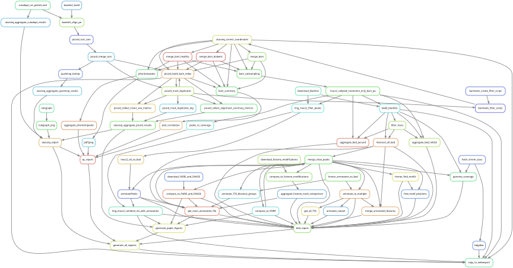

## Introduction

A _workflow management system_ (WfMS) is a piece of software that sets up,
performs and monitors a defined sequence of computational tasks (_i.e._ "a
workflow"). Snakemake is a WfMS that was developed in the bioinformatics
community, and as such it has a number of features that make it particularly
well-suited for creating reproducible and scalable data analyses.

First of all the language you use to formulate your workflows is based on
Python, which is a language with strong standing in academia. However, users
are not required to know how to code in Python to work efficiently with
Snakemake. Workflows can easily be scaled from your desktop to server, cluster,
grid or cloud environments. This makes it possible to develop a workflow on
your laptop, maybe using only a small subset of your data, and then run the
real analysis on a cluster. Snakemake also has several features for defining
the environment with which each task is carried out. This is important in
bioinformatics, where workflows often involve running a large number of small
third-party tools.

Snakemake is primarily intended to work on _files_ (rather than for example
streams, reading/writing from databases or passing variables in memory). This
fits well with many fields of bioinformatics, notably next-generation
sequencing, that often involve computationally expensive operations on large
files. It's also a good fit for a scientific research setting, where the exact
specifications of the final workflow aren't always known at the beginning of
a project.

Lastly, a WfMS is a very important tool for making your analyses reproducible.
By keeping track of when each file was generated, and by which operation, it is
possible to ensure that there is a consistent "paper trail" from raw data to
final results. Snakemake also has features that allow you to package and
distribute the workflow, and any files it involves, once it's done.

This tutorial depends on files from the course GitHub repo. Take a look at the
[setup](../home_precourse.html) for instructions on how to set it up if you
haven't done so already, then open up a terminal and go to
`workshop-reproducible-research/tutorials/snakemake` and activate your
`snakemake-env` Conda environment.

## The basics

In this part of the tutorial we will create a very simple workflow from
scratch, in order to show the fundamentals of how Snakemake works. The workflow
will take two files as inputs, `a.txt` and `b.txt`, and the purpose is to
convert the text in the files to upper case and then to concatenate them.

Run the following shell commands. The first one will make an empty file named
`Snakefile`, which will later contain the workflow. The second and third
commands generate two files containing some arbitrary text.

```bash
touch Snakefile
echo "This is a.txt" > a.txt
echo "This is b.txt" > b.txt
```

Then open `Snakefile` in your favourite text editor. A Snakemake workflow is based on
rules which take some file(s) as input, perform some type of operation on
them, and generate some file(s) as outputs. Here is a very simple rule that
produces `a.upper.txt` as an output, using `a.txt` as input. Copy this rule to
your `Snakefile` and save it.

```{.python filename="Snakefile"}
rule convert_to_upper_case:
    input:
        "a.txt",
    output:
        "a.upper.txt",
    shell:
        """
        tr a-z A-Z <{input} >{output}
        """
```

::: {.callout-caution}
Indentation is important in Snakefiles, so make sure that you have the
correct number of spaces before `input`/`output`/`shell` and their
respective subsections. The number of spaces per level doesn't matter as
long as you're consistent. Here we use four, but you could just as well use
two for a more compact look. Don't use tabs (unless your editor
automatically converts them to spaces).
:::

Rules can be given names, here it's `convert_to_upper_case`. While rule names
are not strictly necessary we encourage you to use them and to make an effort to
name your rules in a way that makes it easy to understand the purpose of the rule,
as rule names are one of the main ways to interact with the workflow. The
`shell` section (or directive) contains the shell commands that will convert the
text in the input file to upper case and send it to the output file. In the shell
command string, we can refer to elements of the rule via curly brackets. Here, we
refer to the output file by specifying `{output}` and to the input file by
specifying `{input}`. If you're not very familiar with Bash, this particular
command can be read like "send the contents of `a.txt` to the program `tr`, which
will convert all characters in the set `a-z` to the corresponding character in
the set `A-Z`, and then send the output to `a.upper.txt`".

Now let's run our first Snakemake workflow. When a workflow is executed
Snakemake tries to generate a set of **target files**. Target files can be
specified via the command line or, as you will see later, in several other ways.
But importantly you will always have to specify what you want Snakemake to
generate, in one way or another. The basic Snakemake command line looks like
this:

```bash
snakemake <arguments> [target files ...]
```

where `<arguments>` are flags that modify the behaviour of Snakemake and
`[target files ...]` are the files that you want Snakemake to generate.

Let's ask Snakemake to generate the file `a.upper.txt`, this is our target file.
For the arguments part we'll use the `-s` flag to specify the file containing
our rules and the `-c` flag to set the number of cores to use. It's good
practice to first run with the flag `-n` (or `--dry-run`), which will show what
Snakemake plans to do without actually running anything. You can also use the
flag `-p`, for showing the shell commands that it will execute. `snakemake
--help` will show you all available flags.

The command thus becomes:

```bash
snakemake -s Snakefile -c 1 -n -p a.upper.txt
```

Snakemake first prints a header with information about the run (Snakemake
version, which Snakefile is used, the working directory and so on). After
that you should see something like this:

```no-highlight
Building DAG of jobs...
Job stats:
job                      count
---------------------  -------
convert_to_upper_case        1
total                        1


[Wed Nov 13 21:59:01 2024]
rule convert_to_upper_case:
    input: a.txt
    output: a.upper.txt
    jobid: 0
    reason: Missing output files: a.upper.txt
    resources: tmpdir=<TBD>
Shell command:
        tr a-z A-Z <a.txt >a.upper.txt

Job stats:
job                      count
---------------------  -------
convert_to_upper_case        1
total                        1

Reasons:
    (check individual jobs above for details)
    output files have to be generated:
        convert_to_upper_case
This was a dry-run (flag -n). The order of jobs does not reflect the order of execution.
```

You can see that Snakemake plans to run one job: the rule
`convert_to_upper_case` with `a.txt` as input and `a.upper.txt` as output. The
reason for doing this is that it's missing the file `a.upper.txt`. Now run the
command without the `-n` flag and check that the contents of `a.upper.txt` are as
expected.

We used the `-s` flag to point to the file containing the rules. In fact,
Snakemake will look for a file named `Snakefile` in the current directory (or in
a subdirectory called `workflow`) by default, which means we can omit this flag
for this example. The command can thus be simplified to:

```bash
snakemake -c 1 -p a.upper.txt
```

Try running this simplified command. What do you see? It turns out that
Snakemake only reruns jobs if there have been changes to either **the input
files, or the workflow itself**. Here neither the `a.txt` input, nor the
`Snakefile` have been changed so Snakemake determines that everything in the
workflow is up to date and there is nothing to do.

What if we ask Snakemake to generate the file `b.upper.txt`? Run the following:

```bash
snakemake -c 1 -n -p b.upper.txt
```

You will see that Snakemake complains that there is no rule to produce
`b.upper.txt`. This is because we have only defined a rule for `a.upper.txt`. We
could copy the rule to make a similar one for `b.txt`, but that would be a bit
cumbersome. Here is where named wildcards come in; one of the most powerful
features of Snakemake. Simply change the input and output directives from 

```{.python filename="Snakefile"}
    input:
        "a.txt",
    output:
        "a.upper.txt",
```

to 

```{.python filename="Snakefile"}
    input:
        "{some_name}.txt",
    output:
        "{some_name}.upper.txt",
```

Now try asking for `b.upper.txt` again.

Tada! What happens here is that Snakemake looks at all the rules it has
available (actually only one in this case) and tries to assign values to all
wildcards so that the targeted files can be generated. In this case you can see
that it says `wildcards: some_name=b`, which means that the `some_name` wildcard
was assigned the value `b`. This was quite simple but for large workflows and
multiple wildcards it can get much more complex. Named wildcards are what enable
a workflow (or single rules) to be efficiently generalized and reused between
projects or shared between people.

Remember that we're trying to make a workflow that will convert two files to
uppercase and concatenate them. It seems we have the first part of our workflow
working, now it's time to make the second rule for concatenating the outputs
from `convert_to_upper_case`. 

The syntax for concatenating two files in Bash is:

```bash
cat first_file.txt second_file.txt > output_file.txt
```

The structure of this second rule will be similar to the first but here we have
two inputs instead of one. This can be expressed in two ways, either with named
inputs like this:

```python
input:
    firstFile="...",
    secondFile="...",
shell:
    """
    some_function {input.firstFile} {input.secondFile} # <1>
    """
```

1. Here we reference the named input

Or with indexes like this:

```python
input:
    "...",
    "...",
shell:
    """
    some_function {input[0]} {input[1]} # <1>
    """
```

1. Here we reference the input files with indexes

::: {.callout-caution}
If you have multiple inputs or outputs they need to be delimited with
a comma (as seen above). This is a very common mistake when writing
Snakemake workflows. The parser will complain, but sometimes the error
message can be difficult to interpret.
:::

Now try to construct this second rule yourself. Add it to the `Snakefile` and
name the rule `concatenate_a_and_b`. Use `a.upper.txt` and `b.upper.txt` as
input and call the output `c.txt`. Check the solution below if you get stuck.


::: {.callout-tip collapse="true" title="Click to show"}
```{.python filename="Snakefile"}
rule concatenate_a_and_b:
    input:
        "a.upper.txt",
        "b.upper.txt",
    output:
        "c.txt",
    shell:
        """
        cat {input[0]} {input[1]} >{output}
        """
```
:::

Now try to generate the file `c.txt` with your workflow by running:

```bash
snakemake -c 1 -p c.txt
``` 

Validate that the output looks as expected.

Good job! You've now created a simple Snakemake workflow that converts two files
to uppercase and concatenates them.

### Wildcards

Wouldn't it be nice if our workflow could be used for _any_ files, not just
`a.txt` and `b.txt`? We can achieve this by generalizing the
`concatenate_a_and_b` rule using named wildcards. 

As we've mentioned, Snakemake looks at all the rules it has available and tries
to assign values to all wildcards so that the targeted files can be generated.
We therefore have to name the output file in a way so that it contains
information about which input files it should be based on. Try to figure out how
to modify the `concatenate_a_and_b` rule yourself. If you're stuck you can look
at the solution below, but spend some time on it before you look. Also rename
the `concatenate_a_and_b` rule to `concatenate_files` to reflect its new more
general use.

::: {.callout-tip collapse="true" title="Click to show"}
```{.python filename="Snakefile"}
rule concatenate_files:
    input:
        "{first}.upper.txt", # <1>
        "{second}.upper.txt", # <1>
    output:
        "{first}_{second}.txt", # <2>
    shell:
        """
        cat {input[0]} {input[1]} >{output}
        """
```

1. The two input file names are generalized to contain the `{first}` and
   `{second}` wildcards.
2. By adding these two wildcards to the output file, Snakemake can figure out
   what input files are needed.

:::

We can now control which input files to use by the name of the file we ask
Snakemake to generate. Run the workflow to create a file `a_b.txt`:

```bash
snakemake -c 1 -p a_b.txt
```

You will see that Snakemake assigned the values `a` and `b` to the wildcards
`{first}` and `{second}`, respectively. This is because the output of the
`concatenate_files` rule is defined as `"{first}_{second}.txt"`, which means
that when we ask for `a_b.txt`, the `{first}` wildcard is assigned `a` and the
`{second}` wildcard is assigned `b`. Try to generate the file `b_a.txt` and see
what happens.


::: {.callout-tip}
You can name a file whatever you want in a Snakemake workflow, but you will find
that everything falls into place much nicer if the filename reflects the file's
path through the workflow, _e.g._ `sample_a.trimmed.deduplicated.sorted.bam`. 
:::

### Input functions

The input to Snakemake rules has to be strings or lists of strings, however you
don't have to specify these strings directly in the `input:` section of rules.
Instead, you can define Python functions that return strings or lists of strings
and use these to pass input to Snakemake rules. This allows you to supply input
to rules that can vary depending on the wildcards being used. We'll get to why
that's useful in a sec, but first let's put it to use for the `concatenate_files`
rule. Because Snakemake is based on Python we can mix rule definitions with
standard Python code in the same file. Add a function just above the
`concatenate_files` rule that looks like this:

```{.python filename="Snakefile"}
def concat_input(wildcards):
    files = [wildcards.first + ".upper.txt", wildcards.second + ".upper.txt"]
    return files
```

This is the syntax to define a function in Python. The `def
concat_input(wildcards):` line shows the name of the function (`concat_input`)
and the variable passed to the function (the `wildcards` object). In the second
line we add two items to a list that we call `files` and add the '.upper.txt'
suffix to each item. Finally, the function returns the list. Because the
`concatenate_files` rule has two wildcards `{first}` and `{second}` we can
access the actual strings in the `wildcards` object using `wildcards.first` and
`wildcards.second`. When we ask for the file `a_b.txt` then `wildcards.first ==
'a'` and `wildcards.second == 'b'`. This means that the `files` list returned by
the function will be `['a.upper.txt', 'b.upper.txt']`.

Now that we've defined the function to use as input, we can use it in the
`concatenate_files` rule. Update the rule so that it looks like this:

```{.python filename="Snakefile"}
rule concatenate_files:
    input:
        concat_input,
    output:
        "{first}_{second}.txt",
    shell:
        """
        cat {input[0]} {input[1]} >{output}
        """
```

You see that the name of the function `concat_input` is added in place of the
input strings. When using the `wildcards` object in input functions like this we
have to call the function without any arguments (simply `concat_input`) and the
function has to be defined to accept a single argument (here `def
concat_input(wildcards):`). Let's run the workflow with the updated rule. Remove
the file `a_b.txt` or add `-f` to the Snakemake command to force a re-run:

```bash
snakemake -c 1 -f a_b.txt
```

There are a number of possible use-cases for input functions. For example, say
that you have an experiment where you've sequenced three samples: `sample1`,
`sample2` and `sample3` with the corresponding FASTQ files under `data/` and you
want to write a rule that outputs the statistics of all sequences within each
sample. However, samples `sample1` and `sample2` have been sequenced with
single-end technology while `sample3` has paired-end reads. The single-end
samples will have only one FASTQ file whereas the paired-end sample will have
two (one for each sequenced end). Thus, depending on the name of the sample the
input to the rule will either be one file or two. With input functions we
can write a generalized rule that can handle both types:

```python
def fastq_input(wildcards):
    if wildcards.sample_id in ["sample1", "sample2"]:
        return "data/" + wildcards.sample_id + ".fastq.gz"
    else:
        return [
            "data/" + wildcards.sample_id + ".R1.fastq.gz",
            "data/" + wildcards.sample_id + ".R2.fastq.gz",
        ]


rule fastq_stats:
    input:
        fastq_input,
    output:
        "{sample_id}.stats.txt",
    shell:
        """
        seqtk comp {input} >{output}
        """
```

As you can see, the `fastq_stats` rule takes as input the value returned from
the `fastq_input` function and outputs one file `{sample_id}.stats.txt`. In this
function the sample id is evaluated and if it is either `sample1` or `sample2`
(our single-end samples) then the function returns a single string which is the
path to the FASTQ file for that sample. Otherwise, the function returns a list
containing both the `R1` and `R2` files for the sample. In the `shell:`
directive of the rule the `seqtk comp` command is run on the input and the
output is sent to the output file.


::: {.callout-note title="Quick recap"}
In this section we've learned:

- How a simple Snakemake rule looks.
- How to define target files when executing a workflow.
- How to use named wildcards for writing generic and flexible rules.
- How to use input functions in rules
:::

## Visualising workflows

All that we've done so far could quite easily be done in a simple shell script
that takes the input files as parameters. Let's now take a look at some of the
features where a WfMS like Snakemake really adds value compared to a more
straightforward approach. One such feature is the possibility to visualize your
workflow. Snakemake can generate three types of graphs, one that shows how the
rules are connected, one that shows how the jobs (_i.e._ an execution of
a rule with some given inputs/outputs/settings) are connected, and finally one
that shows rules with their respective input/output files.

First we look at the rule graph. The following command will generate a rule
graph in the dot language and pipe it to the program `dot`, which in turn will
save a visualization of the graph as a PNG file (if you're having trouble
displaying PNG files you could use SVG or JPG instead).

```bash
snakemake --rulegraph dot a_b.txt | dot -Tpng > rulegraph.png
```

::: {.callout-note}
The `--rulegraph` and `--dag` flags take an optional argument for the output
format (`dot` or `mermaid-js`). If you put a target file directly after the
flag, _e.g._ `snakemake --rulegraph a_b.txt`, Snakemake interprets `a_b.txt`
as the format and exits with an error. Either specify the format explicitly,
as above, or put the target before the flag.
:::

```{dot}
//| echo: false
//| label: "rulegraph.png"
digraph snakemake_dag {
    graph[bgcolor=white, margin=1];
    node[shape=box, style=rounded, fontname=sans,                 fontsize=10, penwidth=1];
    edge[penwidth=1, color=grey];
        0[label = "concatenate_files", color = "0.00 0.6 0.85", style="rounded"];
        1[label = "convert_to_upper_case", color = "0.22 0.6 0.85", style="rounded"];
        1 -> 0
}
```

This looks simple enough, the output from the rule `convert_to_upper_case` will
be used as input to the rule `concatenate_files`.

For a more typical bioinformatics project it can look something like this when you
include all the rules from processing of the raw data to generating figures for the paper.



While saying that it's easy to read might be a bit of a stretch, it definitely
gives you a better overview of the project than you would have without a WfMS.

The second type of graph is based on the jobs, and looks like this for our
little workflow (use `--dag` instead of `--rulegraph`).

```bash
snakemake --dag dot a_b.txt | dot -Tpng > jobgraph.png
```

```{dot}
//| echo: false
//| label: "jobgraph.png"
digraph snakemake_dag {
    graph[bgcolor=white, margin=1];
    node[shape=box, style=rounded, fontname=sans,                 fontsize=10, penwidth=1];
    edge[penwidth=1, color=grey];
        0[label = "concatenate_files\nfirst: a\nsecond: b", color = "0.00 0.6 0.85", style="rounded,dashed"];
        1[label = "convert_to_upper_case\nsome_name: a", color = "0.22 0.6 0.85", style="rounded,dashed"];
        2[label = "convert_to_upper_case\nsome_name: b", color = "0.22 0.6 0.85", style="rounded,dashed"];
        1 -> 0
        2 -> 0
}
```

The main difference here is that now each node is a job instead of a rule. You
can see that the wildcards used in each job are also displayed. Another
difference is the dashed lines around the nodes. A dashed line is Snakemake's
way of indicating that this job doesn't need to be rerun in order to generate
`a_b.txt`. Validate this by running `snakemake -c 1 -n a_b.txt` and it should say
that there is nothing to be done.

Let's take a look at the final type of graph that Snakemake can generate, this
is done with the `--filegraph` flag and will show the rules and their input and
output files.

```bash
snakemake --filegraph a_b.txt | dot -Tpng > filegraph.png
```

```{dot}
//| label: filegraph.png
//| echo: false

digraph snakemake_dag {
    graph[bgcolor=white, margin=1];
    node[shape=box, style=rounded, fontname=sans,                 fontsize=10, penwidth=1];
    edge[penwidth=1, color=grey];
0 [ shape=none, margin=0, label=<<table border="2" color="#D95757" cellspacing="3" cellborder="0">
<tr><td>
<b><font point-size="18">concatenate_files</font></b>
</td></tr>
<hr/>
<tr><td align="left"> <b><font point-size="14">&#8618; input</font></b> </td></tr>
<tr>
<td align="left"><font face="monospace">&lt;input function&gt;</font></td>
</tr>
<hr/>
<tr><td align="right"> <b><font point-size="14">output &rarr;</font></b> </td> </tr>
<tr>
<td align="left"><font face="monospace">{first}_{second}.txt</font></td></tr>
</table>>]
1 [ shape=none, margin=0, label=<<table border="2" color="#57D957" cellspacing="3" cellborder="0">
<tr><td>
<b><font point-size="18">convert_to_upper_case</font></b>
</td></tr>
<hr/>
<tr><td align="left"> <b><font point-size="14">&#8618; input</font></b> </td></tr>
<tr>
<td align="left"><font face="monospace">{some_name}.txt</font></td>
</tr>
<hr/>
<tr><td align="right"> <b><font point-size="14">output &rarr;</font></b> </td> </tr>
<tr>
<td align="left"><font face="monospace">{some_name}.upper.txt</font></td></tr>
</table>>]
        1 -> 0
}
```

In terms of details/complexity the filegraph is an intermediate between the
rulegraph (`--rulegraph`) and the jobgraph (`--dag`). It shows the rules to run
with their respective input and output files (shown with wildcards), but doesn't
show the jobs that will be executed.

## Rerun-triggers

We've discussed before that one of the main purposes of using a WfMS is that it
automatically makes sure that everything is up to date. This is done by
recursively checking that outputs are always newer than inputs for all the
rules involved in the generation of your target files. Now try to change the
contents of `a.txt` to some other text and save it. What do you think will
happen if you run `snakemake -c 1 -n a_b.txt` again?

::: {.callout-tip collapse="true" title="Click to show"}
```no-highlight
Building DAG of jobs...
Job stats:
job                      count
---------------------  -------
concatenate_files            1
convert_to_upper_case        1
total                        2

[Fri Nov 15 10:27:22 2024]
rule convert_to_upper_case:
    input: a.txt
    output: a.upper.txt
    jobid: 1
    reason: Updated input files: a.txt
    wildcards: some_name=a
    resources: tmpdir=<TBD>
[Fri Nov 15 10:27:22 2024]
rule concatenate_files:
    input: a.upper.txt, b.upper.txt
    output: a_b.txt
    jobid: 0
    reason: Input files updated by another job: a.upper.txt
    wildcards: first=a, second=b
    resources: tmpdir=<TBD>
Job stats:
job                      count
---------------------  -------
concatenate_files            1
convert_to_upper_case        1
total                        2

Reasons:
    (check individual jobs above for details)
    input files updated by another job:
        concatenate_files
    updated input files:
        convert_to_upper_case
This was a dry-run (flag -n). The order of jobs does not reflect the order of execution.
```
:::

Were you correct? Also generate the job graph and compare to the one generated
above. What's the difference? 

Now rerun without `-n` and validate that `a_b.txt` contains the new text. Note
that Snakemake doesn't look at the contents of files when trying to determine
what has changed, only at the timestamp for when they were last modified.
Modification time (`mtime`) is one of the **rerun-triggers** used by Snakemake. The other triggers are:

* `code`: changes to the code used to execute commands (`shell:`, `run:` or `script:` directives).
* `input`: changes to the set of input files.
* `params`: changes to the `params:` section.
* `software-env`: changes to the software environment used for rules (`conda:`,
  `container:` or `env-modules:` directives).

Which rerun-trigger(s) to use is handled via the `--rerun-triggers` command line
flag. By default, all of them are on.

To see this in practice, modify the `shell:` directive of the rule
`concatenate_files` to also include which files were concatenated.

```{.python filename="Snakefile"}
rule concatenate_files:
    input:
        concat_input,
    output:
        "{first}_{second}.txt",
    shell:
        """
        echo 'Concatenating {input}' | cat - {input[0]} {input[1]} >{output}
        """
```

::: {.callout-note}
It's not really important for the tutorial, but the shell command used here
first outputs "Concatenating " followed by a space delimited list of the
files in `input`. This string is then sent to the program `cat` where it's
concatenated with `input[0]` and `input[1]` (the parameter `-` means that
it should read from standard input). Lastly, the output from `cat` is sent
to `{output}`.
:::

If you now run:

```bash
snakemake -c 1 -n a_b.txt
```

you should see:

```no-highlight
rule concatenate_files:
    input: a.upper.txt, b.upper.txt
    output: a_b.txt
    jobid: 0
    reason: Code has changed since last execution
    wildcards: first=a, second=b
```

Although no files involved in the workflow have been changed, Snakemake
recognizes that the workflow code itself has been modified and this triggers a
re-run.

Now instead run with:

```bash
snakemake -c 1 --rerun-triggers mtime -n a_b.txt
```

With `mtime` (modification time) as the only rerun-trigger Snakemake decides
that all files are up to date.

You can also export information on how all files were generated (when, by which
rule, which version of the rule, and by which commands) to a tab-delimited file
like this:

```bash
snakemake a_b.txt -D > summary.tsv
```

The content of `summary.tsv` is shown in the table below:

| output_file | date                  | rule                    | log-file(s) | input-file(s)          | shellcmd                                  | status                     | plan            |
|-------------|-----------------------|-------------------------|-------------|------------------------|-------------------------------------------|----------------------------|-----------------|
| a_b.txt     | Fri Nov 15 10:32:04 2024 | concatenate_files       |             | a.upper.txt,b.upper.txt | cat a.upper.txt b.upper.txt >a_b.txt      | rule implementation changed | update pending  |
| a.upper.txt | Fri Nov 15 10:32:04 2024 | convert_to_upper_case   |             | a.txt                  | tr a-z A-Z <a.txt >a.upper.txt        | ok                         | no update       |
| b.upper.txt | Thu Nov 14 00:04:06 2024 | convert_to_upper_case   |             | b.txt                  | tr a-z A-Z <b.txt >b.upper.txt        | ok                         | no update       |

: summary.tsv {.responsive .sm}

You can see in the second last column that the rule implementation for `a_b.txt`
has changed. The last column shows if Snakemake plans to regenerate the files
when it's next executed. You can see that for the `concatenate_files` rule the
plan is `update pending` because we generated the summary with the default
behaviour of using all rerun-triggers.

You might wonder where Snakemake keeps track of all these things? It stores all
information in a hidden subdirectory called `.snakemake`. This is convenient
since it's easy to delete if you don't need it anymore and everything is
contained in the project directory. Just be sure to add it to `.gitignore` so
that you don't end up tracking it with git.

By now you should be familiar with the basic functionality of Snakemake, and
you can build advanced workflows with only the features we have discussed here.
There's a lot we haven't covered though, in particular when it comes to making
your workflow more reusable. In the following section we will start with
a workflow that is fully functional but not very flexible. We will then
gradually improve it, and at the same time showcase some Snakemake features
we haven't discussed yet.

::: {.callout-note title="Quick recap"}
In this section we've learned:

- How to use `--rulegraph`, `--dag` and `--filegraph` for visualizing the workflow.
- How Snakemake reruns relevant parts of the workflow after
  there have been changes.
- How Snakemake tracks changes to files and code in a workflow
:::

## The MRSA workflow

As you might remember from the [intro](introduction.html), we are attempting to
understand how lytic bacteriophages can be used as a future therapy for the
multi-resistant bacterium MRSA (methicillin-resistant _Staphylococcus aureus_).
In order to do this we have performed RNA-seq of three strains, one test and two
controls. We have already set up a draft Snakemake workflow for the RNA-seq
analysis and it seems to be running nicely. The rest of the Snakemake tutorial
will be spent improving and making this workflow more flexible.

You are probably already in your `snakemake-env` environment, otherwise
activate it (use `conda info --envs` if you are unsure).

Let's start by generating the rule graph so that we get an overview of the
workflow. Here we have to specify the file with the rules using the `-s`
flag to Snakemake since the path to the file differs from the default.

```bash
snakemake -s snakefile_mrsa.smk --rulegraph | dot -T png > rulegraph_mrsa.png
```

There's another difference in this command compared to the one we've used
before, namely that we don't define a target. In the toy example we used
`a_b.txt` as a target, and the wildcards were resolved based on that. How come
we don't need to do that here? This is because by default Snakemake uses
the first rule in a workflow as its target, unless a target is specified on the
command line. By convention, this rule is called `all` and serves as a rule
for aggregating the main outputs of the workflow.

```{dot}
//| echo: false
//| label: MRSA_rulegraph
digraph MRSA_rulegraph {
    graph[bgcolor=white, margin=0];
    node[shape=box, style=rounded, fontname=sans,                 fontsize=14, penwidth=2];
    edge[penwidth=2, color=grey];
        0[label = "all", color = "0.07 0.6 0.85", style="rounded"];
        1[label = "generate_count_table", color = "0.20 0.6 0.85", style="rounded"];
        2[label = "sort_bam", color = "0.60 0.6 0.85", style="rounded"];
        3[label = "align_to_genome", color = "0.00 0.6 0.85", style="rounded"];
        4[label = "download_fastq_files", color = "0.27 0.6 0.85", style="rounded"];
        5[label = "index_genome", color = "0.47 0.6 0.85", style="rounded"];
        6[label = "get_genome_fasta", color = "0.33 0.6 0.85", style="rounded"];
        7[label = "get_genome_gff3", color = "0.40 0.6 0.85", style="rounded"];
        8[label = "multiqc", color = "0.53 0.6 0.85", style="rounded"];
        9[label = "fastqc", color = "0.13 0.6 0.85", style="rounded"];
        8 -> 0
        1 -> 0
        7 -> 1
        2 -> 1
        3 -> 2
        5 -> 3
        4 -> 3
        6 -> 5
        9 -> 8
        4 -> 9
} 
```

As you can see from the `snakefile_mrsa.smk` and the rulegraph, the input to the
`all` rule is the output from the rules `multiqc` and `generate_count_table`.
These rules in turn have their own inputs from other rules and by targeting the
`all` rule Snakemake determines what needs to be run by resolving the graph from
bottom to top.

Now take some time and look through the workflow file and try to understand how
the rules fit together. Use the rule graph as aid. The rules represent a quite
standard, although somewhat simplified, workflow for RNA-seq analysis. If you
are unfamiliar with the purpose of the different operations (index genome,
FastQC and so on), then take a look at the [intro](introduction.html).

Also generate the job graph in the same manner. Here you can see that three
samples will be downloaded: SRR935090, SRR935091, and SRR935092. The
original sample files contain tens of millions of reads but for the purpose
of this course we have sub-sampled them to 100,000 reads per sample, so that
they are easy to manage, and made them available at the [SciLifeLab Data
Repository](https://figshare.scilifelab.se/articles/educational_resource/MRSA_case_study_example_data/22246417).
These FASTQ files will then be quality controlled with FastQC and aligned to
a genome. The QC output will be aggregated with MultiQC and the alignments
will be used to generate a count table, _i.e._ a table that shows how many
reads map to each gene for each sample. This count table is then what the
downstream analysis will be based on.

```{dot}
//| echo: false
//| label: MRSA_jobgraph
digraph MRSA_jobgraph {
    graph[bgcolor=white, margin=0];
    node[shape=box, style=rounded, fontname=sans,                 fontsize=10, penwidth=2];
    edge[penwidth=2, color=grey];
        0[label = "all", color = "0.07 0.6 0.85", style="rounded"];
        1[label = "generate_count_table", color = "0.20 0.6 0.85", style="rounded"];
        2[label = "sort_bam", color = "0.60 0.6 0.85", style="rounded"];
        3[label = "align_to_genome", color = "0.00 0.6 0.85", style="rounded"];
        4[label = "download_fastq_files\nsample_id: SRR935090", color = "0.27 0.6 0.85", style="rounded"];
        5[label = "index_genome", color = "0.47 0.6 0.85", style="rounded"];
        6[label = "get_genome_fasta", color = "0.33 0.6 0.85", style="rounded"];
        7[label = "sort_bam", color = "0.60 0.6 0.85", style="rounded"];
        8[label = "align_to_genome", color = "0.00 0.6 0.85", style="rounded"];
        9[label = "download_fastq_files\nsample_id: SRR935091", color = "0.27 0.6 0.85", style="rounded"];
        10[label = "sort_bam", color = "0.60 0.6 0.85", style="rounded"];
        11[label = "align_to_genome", color = "0.00 0.6 0.85", style="rounded"];
        12[label = "download_fastq_files\nsample_id: SRR935092", color = "0.27 0.6 0.85", style="rounded"];
        13[label = "get_genome_gff3", color = "0.40 0.6 0.85", style="rounded"];
        14[label = "multiqc", color = "0.53 0.6 0.85", style="rounded"];
        15[label = "fastqc", color = "0.13 0.6 0.85", style="rounded"];
        16[label = "fastqc", color = "0.13 0.6 0.85", style="rounded"];
        17[label = "fastqc", color = "0.13 0.6 0.85", style="rounded"];
        1 -> 0
        14 -> 0
        2 -> 1
        7 -> 1
        10 -> 1
        13 -> 1
        3 -> 2
        4 -> 3
        5 -> 3
        6 -> 5
        8 -> 7
        9 -> 8
        5 -> 8
        11 -> 10
        12 -> 11
        5 -> 11
        15 -> 14
        16 -> 14
        17 -> 14
        4 -> 15
        9 -> 16
        12 -> 17
}  
```

Now let's run the whole workflow. As before, specify `-p` to have Snakemake
print the shell commands for rules and use `-c` to control how many cores to run
with. Let's run the workflow with one core:

```bash
snakemake -s snakefile_mrsa.smk -c 1 -p
```

After everything is done, the workflow will have generated FASTQ files for each
sample under `data/` and reference genome files under `data/ref`. The `results/`
directory will contain the output from the different steps in the workflow,
divided into subdirectories. Take some time to look through the structure.

::: {.callout-note title="Quick recap"}
In this section we've learned:

- How the MRSA workflow looks.
- How to run the MRSA workflow.
- Which output files the MRSA workflow produces.
:::

## Parameters and configuration

In a typical bioinformatics project, considerable efforts are spent on tweaking
parameters for the various programs involved. It would be inconvenient if you
had to change in the shell scripts themselves every time you wanted to run with
a new setting. Luckily, there is a better option for this: the `params`
keyword.

```python
rule some_rule:
    input:
        "some_input.txt",
    output:
        "results/some_output.txt",
    params:
        cutoff=2.5,
    shell:
        """
        some_program --cutoff {params.cutoff} {input} {output}
        """
```

In the toy example above, the params directive has one keyword called `cutoff`
which is set to `2.5` and this value can be accessed in the shell command with
`{params.cutoff}`. 

In the MRSA workflow most of the programs are run with default settings and
don't use the `params:` directive. However, the `download_fastq_files` rule is
an exception. In this rule the `url` parameter is set using a function, which is
similar to what you did in the [Input functions](#input-functions) section.
Using a function to return values based on wildcards also works for `params:`. 

```{.python filename="snakefile_mrsa.smk" .code-overflow-scroll}
def get_sample_url(wildcards): # <1>
    samples = { # <2>
        "SRR935090": "https://ndownloader.figshare.com/files/39539767", # <2>
        "SRR935091": "https://ndownloader.figshare.com/files/39539770", # <2>
        "SRR935092": "https://ndownloader.figshare.com/files/39539773", # <2>
    } # <2>
    return samples[wildcards.sample_id] # <3>

# Retrieve a single-read FASTQ file
rule download_fastq_files:
    output:
        "data/{sample_id}.fastq.gz",
    params:
        url=get_sample_url, # <4>
    shell:
        """
        curl -fsSL {params.url} | seqtk sample - 25000 | gzip -c >{output[0]} # <5>
        """
```

1. The `get_sample_url` function takes the `wildcards` object as its single argument.
2. The `samples` variable defined in the function is a Python
[dictionary](https://docs.python.org/3/tutorial/datastructures.html#dictionaries)
that has the URLs for each sample_id hard-coded. This dictionary is used to
convert the value of the `sample_id` wildcard to a URL.
3. The URL is returned by the function.
4. The `url` parameter in the rule calls the `get_sample_url` which returns a URL depending on the value of the `sample_id` wildcard.
5. Finally, in the `shell:` directive we access the `url` parameter with
`{params.url}`.

Let's add another parameter to the `download_fastq_files` rule. As you can see
in the shell command the FASTQ file downloaded by `curl` gets piped directly to
the `seqtk sample` command which reads from STDIN and outputs 25000 randomly
sampled reads (out of the 100,000 contained in the example FASTQ file). Change
the rule to use a parameter `max_reads` instead of the hard-coded value and set
it to 20000.

If you need help, click to show the solution below.

::: {.callout-tip collapse="true" title="Click to show"}

```{.python filename="snakefile_mrsa.smk" .code-overflow-scroll}
rule download_fastq_files:
    output:
        "data/{sample_id}.fastq.gz",
    params:
        url=get_sample_url,
        max_reads=20000,
    shell:
        """
        curl -fsSL {params.url} | seqtk sample - {params.max_reads} | gzip -c >{output[0]}
        """
```
:::

Now run the workflow again with:

```bash
snakemake -s snakefile_mrsa.smk -p -c 1
```

Because there have been changes to the `download_fastq_files` rule this will
trigger a re-run of the rule for all three accessions. In addition all
downstream rules that depend on output from `download_fastq_files` are re-run.

As you can see the parameter values we set in the `params` section don't have to
be static, they can be any Python expression. In particular, Snakemake provides
a global dictionary of configuration parameters called `config`. Let's modify
`download_fastq_files` in order to make use of this dictionary:

```{.python filename="snakefile_mrsa.smk" .code-overflow-scroll}
rule download_fastq_files:
    output:
        "data/{sample_id}.fastq.gz",
    params:
        url=get_sample_url,
        max_reads=config["max_reads"],
    shell:
        """
        curl -fsSL {params.url} | seqtk sample - {params.max_reads} | gzip -c >{output[0]}
        """
```

Note that Snakemake now expects there to be a key named `max_reads` in the config
dictionary. If we don't populate the dictionary somehow the dictionary will be
empty so if you were to run the workflow now it would trigger a `KeyError` (try
running `snakemake -s snakefile_mrsa.smk -n` to see for yourself).
In order to populate the config dictionary with data for the workflow we could
use the `snakemake --config KEY=VALUE` syntax directly from the command line
(_e.g._ `snakemake --config max_reads=20000 -s snakefile_mrsa.smk`).
However, from a reproducibility perspective, it's not optimal to set parameters
from the command line, since it's difficult to keep track of which parameter
values were used.

A much better alternative is to use the `--configfile FILE` option to supply a
configuration file to Snakemake. In this file we can collect all the
project-specific settings, sample ids and so on. This also enables us to write
the Snakefile in a more general manner so that it can be better reused between
projects. Like several other files used in these tutorials, this file should be
in [YAML format](https://en.wikipedia.org/wiki/YAML). 

::: {.callout-tip}
A [command-line YAML linter](https://yamllint.readthedocs.io/en/stable/) or an
[online linter](https://yamline.com/validator/) can help you debug YAML syntax
if you encounter problems. 
:::

Create the file below and save it as `config.yml` (here we change back to using
25000 reads):

```{.yaml filename="config.yml"}
max_reads: 25000
```

If we now run Snakemake with `--configfile config.yml`, it will parse this file
to form the `config` dictionary. Try it out by running:

```bash
snakemake -s snakefile_mrsa.smk --configfile config.yml -p -c 1
```

Configuration settings that you specify with `--config KEY=VALUE` on the command
line will overwrite settings specified in a config file. This can be useful if
you want to run the workflow with a different setting for a specific parameter
for testing purposes.

::: {.callout-tip}
Rather than supplying the config file from the command line you could also
add the line `configfile: "config.yml"` to the top of your Snakefile. Keep in
mind that with such a setup Snakemake will complain if the file `config.yml`
is not present.
:::

There's one more rule in `snakefile_mrsa.smk` that uses `params:`, namely the
`fastqc` rule:

```{.python filename="snakefile_mrsa.smk"}
rule fastqc:
    input:
        "data/{sample_id}.fastq.gz",
    output:
        "results/fastqc/{sample_id}_fastqc.html",
        "results/fastqc/{sample_id}_fastqc.zip",
    params:
        output_dir=subpath(output[0], parent=True), # <1>
    shell:
        """
        fastqc {input} -q -o {params.output_dir} # <2>
        """
```

1. Here, the `output_dir` parameter is set using the `subpath` Snakemake helper
   function. The function takes one of the output files and returns the parent
   directory of the file (`parent=True`).
2. The `output_dir` parameter is then used in the shell directive to specify the
   output directory for `fastqc`.

Snakemake comes with several so called [Semantic
helper](https://snakemake.readthedocs.io/en/stable/snakefiles/rules.html#helpers-for-defining-rules)
functions like this which can simplify your workflow code.

::: {.callout-note title="Quick recap"}
In this section we've learned:

- How to set parameter values with the `params` directive.
- How to run Snakemake with the `config` variable and with a configuration file.
:::

## Logs

As you probably noticed it was difficult to follow how the workflow progressed
since some rules printed a lot of output to the terminal. In some cases this
also contained important information, such as statistics on the sequence
alignments or genome indexing. This could be valuable for example if you later
in the project get weird results and want to debug. It's also important from
a reproducibility perspective that the "paper trail" describing how the outputs
were generated is saved. Luckily, Snakemake has a feature that can help with
this. Just as we define `input` and `output` in a rule we can also define
`log`.

```python
rule some_rule:
    input:
        "some_input.txt",
    output:
        "results/some_output.txt",
    log:
        "logs/some_log.txt",
    shell:
        """
        some_program {input} {output} >{log}
        """
```

A log file is not different from any other output file, but it's dealt with a
little differently by Snakemake. For example, it's shown in the file summary
when using `-D` and unlike other output files it's not deleted if jobs fail,
which of course is necessary for debugging purposes. It's also a good way to
clarify the purpose of the file. 

::: {.callout-important}
To avoid having multiple jobs write to the same files Snakemake requires that
all output and log files contain the same wildcards.
:::

It is recommended to use a log file for all rules in a workflow. However, the
most important rules to save logs for in this workflow are:

- `multiqc` which aggregates quality control data for all the samples into one html
  report, and the log contains information about which samples were aggregated.
- `get_genome_fasta` and `get_genome_gff3` would be good to log since they are
  dependent on downloading files from an external server.
- `index_genome` which outputs some statistics about the genome indexing.
- `align_to_genome` which outputs important statistics about the alignments.
  This is probably the most important log to save.
- `generate_count_table` which outputs information about input files, settings
  and a summary of results.


Now add a log file to the rules `multiqc`, `get_genome_fasta`,
`get_genome_gff3`, `index_genome`, `align_to_genome` and `generate_count_table`.
A good place to save them is under `results/logs/`, _e.g._
`results/logs/<rule_name>.log`, or `results/logs/<rule_name>/{sample_id}.log`
for rules that run once per sample.

You also have to specify in the `shell` section of each rule what you want the
log to contain. Some of the programs we use send their log information to
standard out, some to standard error and some let us specify a log file via a
flag. For example, `bowtie2` used in the `align_to_genome` rule writes log info
to standard error so we use `2>{log}` to redirect this to the log file:

```{.python filename="snakefile_mrsa.smk"}
rule align_to_genome:
    input:
        "data/{sample_id}.fastq.gz",
        "results/bowtie2/NCTC8325.1.bt2",
        "results/bowtie2/NCTC8325.2.bt2",
        "results/bowtie2/NCTC8325.3.bt2",
        "results/bowtie2/NCTC8325.4.bt2",
        "results/bowtie2/NCTC8325.rev.1.bt2",
        "results/bowtie2/NCTC8325.rev.2.bt2",
    output:
        "results/sam/{sample_id}.sam",
    log:
        "results/logs/align_to_genome/{sample_id}.log",
    shell:
        """
        bowtie2 -x results/bowtie2/NCTC8325 -U {input[0]} >{output} 2>{log}
        """
```

For programs used in the rules `multiqc`, `get_genome_fasta`, `get_genome_gff3`,
`index_genome` and `generate_count_table` you can use the table below if you
need help with how to redirect output to the log file. Note that for some
programs the redirect is `>{log} 2>&1`. This means that we send standard
output to the log file and standard error to wherever stdout goes. It's
simply a way to send both streams to the same file.

| Rule      | Program        | Redirect flag  |
|-----------|----------------|----------------|
| `multiqc` | `multiqc` | `>{log} 2>&1` |
| `get_genome_fasta`/`get_genome_gff3` | `wget` | `-o {log}` |
| `index_genome` | `bowtie2-build` | `>{log} 2>&1` |
| `generate_count_table` | `featureCounts` | `>{log} 2>&1` |


If you need help, click to show the solution below for the rules.

::: {.callout-tip collapse="true" title="Click to show"}
```{.python filename="snakefile_mrsa.smk" .code-overflow-scroll}
rule multiqc:
    input:
        "results/fastqc/SRR935090_fastqc.zip",
        "results/fastqc/SRR935091_fastqc.zip",
        "results/fastqc/SRR935092_fastqc.zip",
    output:
        html="results/multiqc/multiqc.html",
        stats="results/multiqc/multiqc_general_stats.txt",
    log:
        "results/logs/multiqc.log",
    shell:
        """
        # Run multiQC and keep the html report
        multiqc -n multiqc.html {input} >{log} 2>&1
        mv multiqc.html {output.html}
        mv multiqc_data/multiqc_general_stats.txt {output.stats}

        # Remove the other directory that multiQC creates
        rm -rf multiqc_data
        """

rule get_genome_fasta:
    output:
        "data/ref/NCTC8325.fa.gz",
    log:
        "results/logs/get_genome_fasta.log",
    shell:
        """
        wget -o {log} https://ftp.ncbi.nlm.nih.gov/genomes/all/GCF/000/013/425/GCF_000013425.1_ASM1342v1/GCF_000013425.1_ASM1342v1_genomic.fna.gz -O {output}
        """

rule get_genome_gff3:
    output:
        "data/ref/NCTC8325.gff3.gz",
    log:
        "results/logs/get_genome_gff3.log",
    shell:
        """
        wget -o {log} https://ftp.ncbi.nlm.nih.gov/genomes/all/GCF/000/013/425/GCF_000013425.1_ASM1342v1/GCF_000013425.1_ASM1342v1_genomic.gff.gz -O {output}
        """

rule index_genome:
    input:
        "data/ref/NCTC8325.fa.gz",
    output:
        "results/bowtie2/NCTC8325.1.bt2",
        "results/bowtie2/NCTC8325.2.bt2",
        "results/bowtie2/NCTC8325.3.bt2",
        "results/bowtie2/NCTC8325.4.bt2",
        "results/bowtie2/NCTC8325.rev.1.bt2",
        "results/bowtie2/NCTC8325.rev.2.bt2",
    log:
        "results/logs/index_genome.log",
    shell:
        """
        bowtie2-build {input} results/bowtie2/NCTC8325 >{log} 2>&1
        """

rule generate_count_table:
    input:
        bams=[
            "results/bam/SRR935090.sorted.bam",
            "results/bam/SRR935091.sorted.bam",
            "results/bam/SRR935092.sorted.bam",
        ],
        annotation="data/ref/NCTC8325.gff3.gz",
    output:
        "results/tables/counts.tsv",
    log:
        "results/logs/generate_count_table.log",
    shell:
        """
        featureCounts -t gene -g locus_tag -a {input.annotation} -o {output} {input.bams} >{log} 2>&1
        """
```
:::

After adding log files to the rules, rerun the whole workflow with:

```bash
snakemake -s snakefile_mrsa.smk --configfile config.yml -p -c 1
```

Do the logs contain what they should? Note how much easier it is to follow the
progression of the workflow when the rules write to logs instead of to the
terminal.

::: {.callout-tip}
If you have a rule with a shell directive in which several commands are run
and you want to save stdout and stderr for all commands into the same log file
you can add `exec &>{log}` as the first line of the shell directive.
:::

If you run with `-D` (or `-S` for a simpler version) you will see that the
summary table now also contains the log file for each output file generated by
a rule with a `log` directive.

::: {.callout-note title="Quick recap"}
In this section we've learned:

- How to redirect output to log files with the `log` directive.
:::

## Temporary files

It's not uncommon that workflows contain temporary files that should be kept for
some time and then deleted once they are no longer needed. A typical case could
be that some operation generates a file, which is then compressed to save space
or indexed to make searching faster. There is then no need to save the original
output file. Take a look at the job graph for our workflow again. The output
from `align_to_genome` is a SAM file, which contains information about all the
reads for a sample and where they map in the genome. For downstream processing
we need this file to be sorted by genome coordinates. This is what the rule
`sort_bam` is for. We therefore end up with both `results/sam/{sample_id}.sam`
and `results/bam/{sample_id}.sorted.bam`.

In Snakemake we can mark an output file as temporary like this:

```python
rule some_rule:
    output:
        temp("results/some_output.txt"),
```

The file will then be deleted as soon as all jobs where it's an input have
finished. Let's use the `temp` notation for the output of `align_to_genome`.
Modify the rule so that the `output:` directive looks like this:

```{.python filename="snakefile_mrsa.smk"}
    output:
        temp("results/sam/{sample_id}.sam"),
```

We have to force a rerun of the rule for it to trigger, so we use `--forcerun align_to_genome` to do this. Run the workflow with:

```bash
snakemake -s snakefile_mrsa.smk --configfile config.yml -p -c 1 --forcerun align_to_genome
```

Take a look at the output printed to your terminal. After the rule `sort_bam` you should see something like this:

```no-highlight
Removing temporary output results/sam/SRR935092.sam.
```

If you list the contents of `results/` you should see that the `sam/`
subdirectory is gone and that only the sorted BAM files in `bam/` remain.

::: {.callout-tip}
If you want to prevent Snakemake from deleting files marked as temporary you can
run with the `--notemp` command line flag which will cause Snakemake to ignore
any `temp()` declarations. If you at any point want to delete remaining files
that are declared as temporary in your workflow you can instead run with the
`--delete-temp-output` which will delete all remaining `temp` files.
:::

Snakemake has a number of additional options for marking files, including:

- `protected("...")`: The output file should be write-protected. Typically used
  to protect files that require a huge amount of computational resources from
  being accidentally deleted.
- `ancient("...")`: The timestamp of the input file is ignored and it's always
  assumed to be older than any of the output files.
- `touch("...")`: The output file should be "touched", _i.e._ created or
  updated, when the rule has finished. Typically used as "flag files" to
  enforce some rule execution order without real file dependencies.
- `directory("...")`: The output is a directory rather than a file.

::: {.callout-note title="Quick recap"}
In this section we've learned:

- How to mark an output file as temporary for automatic removal.
:::

## The expand function

Now that we have a working workflow with logs and temporary files, let's look at
a way to make the code more readable.

Consider the rule `align_to_genome` below.

```{.python filename="snakefile_mrsa.smk"}
rule align_to_genome:
    input:
        "data/{sample_id}.fastq.gz",
        "results/bowtie2/NCTC8325.1.bt2",
        "results/bowtie2/NCTC8325.2.bt2",
        "results/bowtie2/NCTC8325.3.bt2",
        "results/bowtie2/NCTC8325.4.bt2",
        "results/bowtie2/NCTC8325.rev.1.bt2",
        "results/bowtie2/NCTC8325.rev.2.bt2",
    output:
        temp("results/sam/{sample_id}.sam"),
    log:
        "results/logs/align_to_genome/{sample_id}.log",
    shell:
        """
        bowtie2 -x results/bowtie2/NCTC8325 -U {input[0]} >{output} 2>{log}
        """
```

Here we have seven inputs: the FASTQ file with the reads and six files with
similar file names from the Bowtie2 genome indexing. Instead of writing all
the filenames we can tidy this up by using the `expand()` helper function.

```{.python}
expand(
    "results/bowtie2/NCTC8325.{substr}.bt2",
    substr=["1", "2", "3", "4", "rev.1", "rev.2"],
),
```

Here `expand` will take the string `"results/bowtie2/NCTC8325.{substr}.bt2"` and
insert each of the values in the `substr` list: `["1", "2", "3", "4", "rev.1",
"rev.2"]` in place of `{substr}`. The result is a list of strings that is used
as input to the rule. This is a very powerful feature that can save you a lot of
typing and make your code more readable.

Update the `align_to_genome` rule to use the `expand()` function in the input.
Click the solution below if you need help.

::: {.callout-tip collapse="true" title="Click to show"}
```{.python filename="snakefile_mrsa.smk"}
rule align_to_genome:
    input:
        "data/{sample_id}.fastq.gz",
        expand(
            "results/bowtie2/NCTC8325.{substr}.bt2",
            substr=["1", "2", "3", "4", "rev.1", "rev.2"],
        ),
    output:
        temp("results/sam/{sample_id}.sam"),
    log:
        "results/logs/align_to_genome/{sample_id}.log",
    shell:
        """
        bowtie2 -x results/bowtie2/NCTC8325 -U {input[0]} >{output} 2>{log}
        """
```
:::

Great! Let's put the `expand` function to more use!

The `multiqc` and `generate_count_table` rules take as input the FastQC zip
files and the sorted BAM files for all three samples, respectively. See the
excerpt below:

```{.python filename="snakefile_mrsa.smk"}
rule multiqc:
    ...
    input:
        "results/fastqc/SRR935090_fastqc.zip",
        "results/fastqc/SRR935091_fastqc.zip",
        "results/fastqc/SRR935092_fastqc.zip",

...

rule generate_count_table:
    ...
    input:
        bams=[
            "results/bam/SRR935090.sorted.bam",
            "results/bam/SRR935091.sorted.bam",
            "results/bam/SRR935092.sorted.bam",
        ],
...
```

Having the files for each sample written explicitly in these rules is how
Snakemake knows to run the workflow for all three samples. However, this is also
a potential source of errors since it's easy to change in one place and forget
to change in the other. Because we can use Python code "everywhere" let's
instead define a list of sample ids and put it at the top of the Snakefile, just
before the rule `all`:

```{.python filename="snakefile_mrsa.smk"}
sample_ids = ["SRR935090", "SRR935091", "SRR935092"]
```

Now use `expand()` in `multiqc` and `generate_count_table` to use `sample_ids` for
the sample ids. For the `multiqc` rule it could look like this:

```{.python filename="snakefile_mrsa.smk"}
    input:
        expand("results/fastqc/{sample_id}_fastqc.zip", sample_id=sample_ids),
```

See if you can update the `generate_count_table` rule in the same manner. If you
need help, click the solution below.

::: {.callout-tip collapse="true" title="Click to show"}
```{.python filename="snakefile_mrsa.smk" .code-overflow-scroll}
rule generate_count_table:
    input:
        bams=expand("results/bam/{sample_id}.sorted.bam", sample_id=sample_ids),
        annotation="data/ref/NCTC8325.gff3.gz",
    output:
        "results/tables/counts.tsv",
    log:
        "results/logs/generate_count_table.log",
    shell:
        """
        featureCounts -t gene -g locus_tag -a {input.annotation} -o {output} {input.bams} >{log} 2>&1
        """
```
:::

Another convenient helper function is `multiext()` which is a simplified variant
of `expand()`. We can use it when input or output files differ by just their
extension. The general syntax is `multiext("some_file", ".ext1", ".ext2")` which
translates to `some_file.ext1, some_file.ext2`. Try to implement this for the `index_genome` rule. Click the solution below if you need help.

::: {.callout-tip collapse="true" title="Click to show"}
```{.python filename="snakefile_mrsa.smk"}
rule index_genome:
    input:
        "data/ref/NCTC8325.fa.gz",
    output:
        multiext(
            "results/bowtie2/NCTC8325",
            ".1.bt2",
            ".2.bt2",
            ".3.bt2",
            ".4.bt2",
            ".rev.1.bt2",
            ".rev.2.bt2",
        ),
    log:
        "results/logs/index_genome.log",
    shell:
        """
        bowtie2-build {input} results/bowtie2/NCTC8325 >{log} 2>&1
        """
```
:::

Now run the workflow again with:

```bash
snakemake -s snakefile_mrsa.smk --configfile config.yml -p -c 1 --forcerun align_to_genome index_genome multiqc generate_count_table
```

to force a rerun of the modified rules and make sure that the workflow still
works as expected.

::: {.callout-note title="Quick recap"}
In this section we've learned:

- How to use the `expand()` and `multiext()` helper functions to make the code
  more readable.
:::

## Shadow rules

Take a look at the `multiqc` rule below:

```{.python filename="snakefile_mrsa.smk"}
rule multiqc:
    input:
        expand("results/fastqc/{sample_id}_fastqc.zip", sample_id=sample_ids),
    output:
        html="results/multiqc/multiqc.html",
        stats="results/multiqc/multiqc_general_stats.txt",
    log:
        "results/logs/multiqc.log",
    shell:
        """
        # Run multiQC and keep the html report
        multiqc -n multiqc.html {input} >{log} 2>&1
        mv multiqc.html {output.html}
        mv multiqc_data/multiqc_general_stats.txt {output.stats}

        # Remove the other directory that multiQC creates
        rm -rf multiqc_data
        """
```

The way MultiQC is run here, a data directory `multiqc_data` is generated in
addition to the final `multiqc.html` report and the `multiqc_general_stats.txt`
file. Only the latter two are kept and the `multiqc_data` directory is removed
as part of the shell command run by the rule.

While it works for this specific workflow, having files and folders that aren't
explicitly tracked by Snakemake as input/output files has some
drawbacks:

- Snakemake cannot clean up these files if the job fails.
- Jobs running in parallel risk writing to the same untracked files at the same
  time.

At the same time, we may not always know the names of all the files that a program
generates and we may only be interested in a few of them.

These issues can be dealt with by using the `shadow` directive for a rule. This
causes each execution of the rule to run in an isolated temporary directory
(located in `.snakemake/shadow/` by default). There are a few options for
`shadow` (for the full list of these options see the [Snakemake
docs](https://snakemake.readthedocs.io/en/stable/snakefiles/rules.html#shadow-rules)).

The simplest is `shadow: "minimal"`, which means that the rule is executed in
an empty shadow directory that the input files to the rule have been symlinked
into. Take the example below:

```python
rule some_rule:
    input:
        "some_input.txt", # <1>
    output:
        "results/some_output.txt",
    shadow:
        "minimal"
    shell:
        """
        touch some_other_junk_file # <2>
        some_program {input} {output} # <3>
        """
```
1. `some_input.txt` gets symlinked into a shadow directory under `.snakemake/shadow/`.
2. The shell commands generate the file `some_other_junk_file` in the shadow directory.
3. The output file is created in the shadow directory and moved to
   `results/some_output.txt` when the job has finished.

When the rule finishes, the shadow directory is removed which means we wouldn't
have to think about manually removing `some_other_junk_file`.

Try implementing the `shadow` directive for the `multiqc` rule so we don't have
to "manually" delete files that aren't tracked by Snakemake. Add `shadow:
"minimal"` and also delete the shell commands that remove the `multiqc_data`
directory. Check the solution below if you need help.

::: {.callout-tip collapse="true" title="Click to show"}
```{.python filename="snakefile_mrsa.smk"}
rule multiqc:
    input:
        expand("results/fastqc/{sample_id}_fastqc.zip", sample_id=sample_ids),
    output:
        html="results/multiqc/multiqc.html",
        stats="results/multiqc/multiqc_general_stats.txt",
    log:
        "results/logs/multiqc.log",
    shadow:
        "minimal"
    shell:
        """
        # Run multiQC and keep the html report
        multiqc -n multiqc.html {input} >{log} 2>&1
        mv multiqc.html {output.html}
        mv multiqc_data/multiqc_general_stats.txt {output.stats}
        """
```
:::

Now run the workflow again with:

```bash
snakemake -s snakefile_mrsa.smk --configfile config.yml -p -c 1
```

and make sure that you don't see the `multiqc_data` directory in your current
working directory after the workflow has finished.

::: {.callout-tip}
Some people use the shadow option for almost every rule and some never
use it at all. One thing to keep in mind is that it leads to some extra file
operations when the outputs are moved to their final location. This is no
issue when the shadow directory is on the same disk as the output directory,
but if you're running on a distributed file system and generate very many
or very large files it might be worth considering other options (see _e.g._
the `--shadow-prefix` flag).
:::

::: {.callout-note title="Quick recap"}
In this section we've learned:

- How to use the shadow option to handle files that are not tracked by Snakemake.
:::

## Generalizing the MRSA workflow

You've now improved the MRSA workflow by making it more readable, adding
log files, a config file etc. However, the workflow is not very general since
it's hard-coded to work with the three samples `SRR935090`, `SRR935091` and
`SRR935092` and the genome `NCTC8325`. If someone would want to use the workflow
with other samples or genomes they would have to change the code in the
Snakefile, which is not optimal. Instead it's a good idea to separate
project-specific parameters from the actual implementation of the workflow. This
allows anyone using the workflow to modify its behaviour without changing the
underlying code, making the workflow more general.

In this section we will go through how to make the workflow more general and
flexible by moving the sample ids and URLs to a configuration file and turning
the reference genome into a wildcard.

### Specifying samples in a configuration file

Remove the `sample_ids = ["SRR935090", "SRR935091", "SRR935092"]` line we added
to the top of `snakefile_mrsa.smk` and add the following to `config.yml`:

```{.yaml filename="config.yml" .code-overflow-scroll}
samples:
  SRR935090: "https://ndownloader.figshare.com/files/39539767"
  SRR935091: "https://ndownloader.figshare.com/files/39539770"
  SRR935092: "https://ndownloader.figshare.com/files/39539773"
```

Now when passing `--configfile config.yml` on the command line
`config["samples"]` will be a dictionary where the keys are the sample ids and
the values are the URLs to the FASTQ files.

Next, modify the `get_sample_url` function to use this dictionary instead of the
hard-coded values:

```{.python filename="snakefile_mrsa.smk"}
def get_sample_url(wildcards):
    return config["samples"][wildcards.sample_id]
```

Now change the `multiqc` and `generate_count_table` rules that use the `expand`
function in the input directive to use `config["samples"].keys()` to expand the
`sample_id` wildcard. This is how it should look for the `multiqc` rule:

```{.python filename="snakefile_mrsa.smk" .code-overflow-scroll}
    input:
        expand(
            "results/fastqc/{sample_id}_fastqc.zip", sample_id=config["samples"].keys()
        ),
```

Try to change the `generate_count_table` rule in the same way. Check the solution below if you need help.

::: {.callout-tip collapse="true" title="Click to show"}
```{.python filename="snakefile_mrsa.smk" .code-overflow-scroll}
rule generate_count_table:
    input:
        bams=expand(
            "results/bam/{sample_id}.sorted.bam", sample_id=config["samples"].keys()
        ),
        annotation="data/ref/NCTC8325.gff3.gz",
    output:
        "results/tables/counts.tsv",
    log:
        "results/logs/generate_count_table.log",
    shell:
        """
        featureCounts -t gene -g locus_tag -a {input.annotation} -o {output} {input.bams} >{log} 2>&1
        """
```
:::

To see that your new implementation works you can do a forced rerun of the modified rules:

```bash
snakemake -s snakefile_mrsa.smk --configfile config.yml -p -c 1 --forcerun generate_count_table multiqc download_fastq_files
```

::: {.callout-tip}

If you were to scale up this workflow with more samples it could become
impractical to have to define the sample ids and URLs by hand in the config
file. A tip then is to have a separate file where samples are listed in one
column and the URLs (or file paths) in another column. With a few lines of
Python code you could then read that list at the start of the workflow and add
each sample to the config dictionary. See
[below](#reading-samples-from-a-file-instead-of-hard-coding-them) for an example
of how to do this.

:::

### Generalizing the genome reference

Now we'll take a look at how to generalize the genome reference used in the
workflow. 

In the `get_genome_fasta` and `get_genome_gff3` rules we have hard-coded URLs to
the FASTA and GFF annotation file for the genome `NCTC8325`. Let's move this
information to the configuration file, and also add information for another
genome, `ST398`. Add the following to `config.yml`:

```{.yaml filename="config.yml" .code-overflow-scroll}
genomes:
  NCTC8325:
    fasta: https://ftp.ncbi.nlm.nih.gov/genomes/all/GCF/000/013/425/GCF_000013425.1_ASM1342v1/GCF_000013425.1_ASM1342v1_genomic.fna.gz
    gff3: https://ftp.ncbi.nlm.nih.gov/genomes/all/GCF/000/013/425/GCF_000013425.1_ASM1342v1/GCF_000013425.1_ASM1342v1_genomic.gff.gz
  ST398:
    fasta: https://ftp.ncbi.nlm.nih.gov/genomes/all/GCF/000/009/585/GCF_000009585.1_ASM958v1/GCF_000009585.1_ASM958v1_genomic.fna.gz
    gff3: https://ftp.ncbi.nlm.nih.gov/genomes/all/GCF/000/009/585/GCF_000009585.1_ASM958v1/GCF_000009585.1_ASM958v1_genomic.gff.gz
```

As you can see this is very similar to what we did with `samples`, it's just
that we have one more nested level. Now to access the URL to the FASTA file for
genome id `NCTC8325` we can use `config["genomes"]["NCTC8325"]["fasta"]`.

Let's now look at how to do the mapping from genome id to FASTA path in the
rule `get_genome_fasta`. This is how the rule currently looks:

```{.python filename="snakefile_mrsa.smk" .code-overflow-scroll}
rule get_genome_fasta:
    output:
        "data/ref/NCTC8325.fa.gz",
    log:
        "results/logs/get_genome_fasta.log",
    shell:
        """
        wget -o {log} https://ftp.ncbi.nlm.nih.gov/genomes/all/GCF/000/013/425/GCF_000013425.1_ASM1342v1/GCF_000013425.1_ASM1342v1_genomic.fna.gz -O {output}
        """
```

Replace the hard-coded `NCTC8325` with a wildcard `{genome_id}` in both the
`output` and `log` directives. We now need to supply the remote paths to the
FASTA file for a given genome id. Because we've added this information to the
config file we just need to pass it to the rule in some way, and just like in
the `download_fastq_files` rule we'll use a function to do the job:


```{.python filename="snakefile_mrsa.smk"}
def get_fasta_path(wildcards):
    return config["genomes"][wildcards.genome_id]["fasta"]

rule get_genome_fasta:
    output:
        "data/ref/{genome_id}.fa.gz",
    log:
        "results/logs/get_genome_fasta/{genome_id}.log",
    params:
        fasta_path=get_fasta_path,
    shell:
        """
        wget -o {log} {params.fasta_path} -O {output}
        """
```

Now change the `get_genome_gff3` rule in a similar manner. Click to see the
solution below if you're having trouble.

::: {.callout-tip collapse="true" title="Click to show"}
```python
def get_gff_path(wildcards):
    return config["genomes"][wildcards.genome_id]["gff3"]

rule get_genome_gff3:
    output:
        "data/ref/{genome_id}.gff3.gz",
    log:
        "results/logs/get_genome_gff3/{genome_id}.log",
    params:
        gff3_path=get_gff_path,
    shell:
        """
        wget -o {log} {params.gff3_path} -O {output}
        """
```
:::

Now let's turn to the `index_genome` rule, which currently only works for the `NCTC8325` genome. 

First replace `NCTC8325` with `{genome_id}` in the `input` and `output`
directives of the rule. Remember that the log file must contain the same
wildcards as the output files, so make sure to update the `log` directive of
the rule too. Because we're adding a `genome_id` wildcard, a good log file
path is `"results/logs/index_genome/{genome_id}.log"`.

Next, we need to replace the hard-coded `results/bowtie2/NCTC8325` in the
shell directive of the rule with the genome id wildcard. Inside the shell
directive we can access the wildcard object with this syntax:
`{wildcards.genome_id}`, so the `bowtie2-build` command should be:

```bash
bowtie2-build {input} results/bowtie2/{wildcards.genome_id} >{log} 2>&1
```

The final rule should look like this:

```{.python filename="snakefile_mrsa.smk"}
rule index_genome:
    input:
        "data/ref/{genome_id}.fa.gz",
    output:
        multiext(
            "results/bowtie2/{genome_id}",
            ".1.bt2",
            ".2.bt2",
            ".3.bt2",
            ".4.bt2",
            ".rev.1.bt2",
            ".rev.2.bt2",
        ),
    log:
        "results/logs/index_genome/{genome_id}.log",
    shell:
        """
        bowtie2-build {input} results/bowtie2/{wildcards.genome_id} >{log} 2>&1
        """
```

Good job! The rules `get_genome_fasta`, `get_genome_gff3` and `index_genome` can
now download and index *any genome* as long as we provide valid links in the
config file.

Only two rules remain where the `NCTC8325` genome id is hard-coded:
`align_to_genome` and `generate_count_table`. We will use these rules to define
which genome id we actually want to use when running the workflow. First add a
parameter to `config.yml` called `"genome_id"` and set it to `NCTC8325`:

```{.yaml filename="config.yml"}
genome_id: "NCTC8325"
```

Now we can resolve the `genome_id` wildcard from the config. For
`align_to_genome` we change the input directive to:

```python
    input:
        "data/{sample_id}.fastq.gz",
        expand(
            "results/bowtie2/{genome_id}.{substr}.bt2",
            genome_id=config["genome_id"],
            substr=["1", "2", "3", "4", "rev.1", "rev.2"],
        ),
```

Here the `substr` wildcard gets expanded from a list while `genome_id` gets
expanded from the config dictionary. We'll also replace the hard-coded
`NCTC8325` in the `shell:` directive of `align_to_genome`. Pass the genome id
to the shell command via `params:`, so that Snakemake tracks it as a parameter
(see the `params` rerun-trigger):

```{.python .code-overflow-scroll}
    params:
        genome_id=config["genome_id"],
    shell:
        """
        bowtie2 -x results/bowtie2/{params.genome_id} -U {input[0]} >{output} 2>{log}
        """
```

The final rule should look like this:

```{.python filename="snakefile_mrsa.smk" .code-overflow-scroll}
rule align_to_genome:
    input:
        "data/{sample_id}.fastq.gz",
        expand(
            "results/bowtie2/{genome_id}.{substr}.bt2",
            genome_id=config["genome_id"],
            substr=["1", "2", "3", "4", "rev.1", "rev.2"],
        ),
    output:
        temp("results/sam/{sample_id}.sam"),
    log:
        "results/logs/align_to_genome/{sample_id}.log",
    params:
        genome_id=config["genome_id"],
    shell:
        """
        bowtie2 -x results/bowtie2/{params.genome_id} -U {input[0]} >{output} 2>{log}
        """
```

Now let's change the hard-coded genome id in the `generate_count_table` input in
a similar manner. The final rule should look like this:

```{.python filename="snakefile_mrsa.smk" .code-overflow-scroll}
rule generate_count_table:
    input:
        bams=expand(
            "results/bam/{sample_id}.sorted.bam", sample_id=config["samples"].keys()
        ),
        annotation=expand("data/ref/{genome_id}.gff3.gz", genome_id=config["genome_id"]),
    output:
        "results/tables/counts.tsv",
    log:
        "results/logs/generate_count_table.log",
    shell:
        """
        featureCounts -t gene -g locus_tag -a {input.annotation} -o {output} {input.bams} >{log} 2>&1
        """
```

To make sure that the workflow works as expected, run it with:

```bash
snakemake -s snakefile_mrsa.smk --configfile config.yml -p -c 1
```

Try changing the `genome_id` in the config file to `ST398` and rerun the
workflow. You should now see that the workflow downloads the genome files for
`ST398` and aligns the samples to that genome instead.

In general, we want the rules as far downstream as possible in the workflow to
be the ones that determine what the wildcards should resolve to. In our case
`align_to_genome` and `generate_count_table`. You can think of it like
the rule that really "needs" the file asks for it, and then it's up to Snakemake
to determine how it can use all the available rules to generate it. Here the
`align_to_genome` rule says "I need this genome index to align my sample to" and
then it's up to Snakemake to determine how to download and build the index.

::: {.callout-note title="Summary"}
Well done! You now have a complete Snakemake workflow with a number of
excellent features:

- A general RNA-seq pipeline which can easily be reused between projects,
  thanks to clear separation between code and settings.
- Great traceability due to logs and summary tables.
- The workflow is neat and free from temporary files due to using `temp()` and
  `shadow`.
- A logical directory structure which makes it easy to separate data and
  results of different software packages.
- A project set up in a way that makes it easy to distribute and reproduce,
  _e.g._ via Git.
:::

## Snakemake best-practices

The workflow you have built is fully functional, but it is not organised the
way a Snakemake workflow typically would be for long-term use. The Snakemake
documentation describes a set of [best
practices](https://snakemake.readthedocs.io/en/stable/snakefiles/best_practices.html)
covering, for example, folder structure, configuration and software
environments.

To show what this can look like for the MRSA workflow, we have included a more
advanced version of it in the `final-workflow/` subdirectory. It is meant as a
reference rather than as the solution to this tutorial. It uses some of the
features covered in the [Extra material](#extra-material) below, such as a
sample sheet, a Conda environment for each rule and a configuration profile,
as well as several features not covered in this tutorial. The `README.md` file
in that directory explains how to run the workflow, which features it uses and
how it differs from the workflow you have created.

## Extra material

If you want to read more about Snakemake in general you can find several
resources here:

- The Snakemake documentation is available on [ReadTheDocs](https://snakemake.readthedocs.io/en/stable/#).
- Here is another (quite in-depth) [tutorial](https://snakemake.readthedocs.io/en/stable/tutorial/tutorial.html#tutorial).
- If you have questions, check out [Stack Overflow](https://stackoverflow.com/questions/tagged/snakemake).

### Reading samples from a file instead of hard-coding them

So far we've specified the samples to use in the workflow either as a hard-coded
list in the Snakefile, or as a list in the configuration file. This is of course
impractical for large real-world examples. Here we'll just quickly show how you
could supply the samples to the MRSA workflow via a sample sheet. For
example you could create a file called `samples.csv` with the following content:

```{.txt filename="samples.csv"}
sample_id,url
SRR935090,https://ndownloader.figshare.com/files/39539767
SRR935091,https://ndownloader.figshare.com/files/39539770
SRR935092,https://ndownloader.figshare.com/files/39539773
```

The first column has the sample id and the second column has the URL to the
FASTQ file. Next we'll add a config parameter `sample_sheet` to the
configuration file:

```{.yaml filename="config.yml"}
sample_sheet: samples.csv
```

Now we'll add some code to `snakefile_mrsa.smk` to read the sample sheet using
the [Pandas](https://pandas.pydata.org/) package. Add the following just above
the `all` rule:

```{.python filename="snakefile_mrsa.smk"}
import pandas as pd # <1>

def read_sample_sheet(f): # <2>
    df = pd.read_csv(f, header=0, index_col=0, sep=",") # <3>
    return df.to_dict(orient="index") # <4>

samples = read_sample_sheet(config["sample_sheet"]) # <5>
```

1. The `pandas` package is imported as an object named `pd`.
2. A function called `read_sample_sheet` is defined which takes one argument `f`, the file to read from.
3. The file is read using the `pd.read_csv` function, the first line is parsed as the header (`header=0`), the first column is set as the index (`index_col=0`) and we specify that the file is comma-separated (`sep=","`).
4. The dataframe is converted to a dictionary and returned.
5. The sample sheet is passed from the config to the `read_sample_sheet` function.

Now the `samples` dictionary will have the structure:

```{.python}
{
    "SRR935090": {"url": "https://ndownloader.figshare.com/files/39539767"},
    "SRR935091": {"url": "https://ndownloader.figshare.com/files/39539770"},
    "SRR935092": {"url": "https://ndownloader.figshare.com/files/39539773"},
}
```

Accessing the URL for one sample thus becomes `samples[wildcards.sample_id]["url"]`.

Update the `get_sample_url` function to make use of the new `samples` dictionary:

```{.python filename="snakefile_mrsa.smk"}
def get_sample_url(wildcards):
    return samples[wildcards.sample_id]["url"]
```

Also update the `multiqc` and `generate_count_table` rules to use the `samples`
dictionary in the `expand` function:

```{.python filename="snakefile_mrsa.smk" .code-overflow-scroll}
rule multiqc:
    input:
        expand("results/fastqc/{sample_id}_fastqc.zip", sample_id=samples.keys()),
...
rule generate_count_table:
    input:
        bams=expand("results/bam/{sample_id}.sorted.bam", sample_id=samples.keys()),
        annotation=expand("data/ref/{genome_id}.gff3.gz", genome_id=config["genome_id"]),
```

You can now remove the `samples:` section from `config.yml`, since the samples
are read from the sample sheet instead. This way, anyone can take our Snakefile
and just update the path to their own `sample_sheet` using the config file.

Force a re-run of the modified rules to make sure everything works after this
update:

```bash
snakemake -s snakefile_mrsa.smk --configfile config.yml -p -c 1 --forcerun generate_count_table multiqc download_fastq_files
```

### Integrated package management

Snakemake supports using isolated software environments for each rule. These can
be Conda environments or containers (_e.g._ Docker images run with Apptainer)
which will be created/spawned by Snakemake and used to execute jobs in the
workflow.

To use a conda environment for a rule you add the `conda:` directive and point
to a conda environment file:

```{.python}
rule some_rule:
    input:
        "some_input.txt",
    output:
        "some_output.txt",
    conda:
        "envs/some_program.yml"
    shell:
        """
        some_program {input} > {output}
        """
```

Let's apply this to the `index_genome` and `align_to_genome` rules. First create
a file `bowtie2.yml` under an `envs/` subdirectory:

```bash
mkdir envs/
touch envs/bowtie2.yml
```

Open `envs/bowtie2.yml` and add:

```{.yaml filename="envs/bowtie2.yml"}
channels:
  - conda-forge
  - bioconda
dependencies:
  - bowtie2=2.5.4
```

Save the file and then modify the `index_genome` and `align_to_genome` rules
with the `conda:` directive, like so:

```{.python filename="snakefile_mrsa.smk"}
    conda:
        "envs/bowtie2.yml"
```

Now run the workflow with the command line flag `--sdm conda` (or `--software-deployment-method conda`):

```bash
snakemake -s snakefile_mrsa.smk --configfile config.yml -p -c 1 --sdm conda
```

Snakemake now creates a conda environment using the `envs/bowtie2.yml` file and
runs the `index_genome` and `align_to_genome` jobs with that environment. These
environments are stored in `.snakemake/conda` by default, but this location can
be modified with the flag `--conda-prefix`.

Docker containers can be utilized in a similar manner by using the `container:` directive. For example, updating the previous two rules to:

```{.python filename="snakefile_mrsa.smk"}
rule index_genome:
    input:
        "data/ref/{genome_id}.fa.gz",
    output:
        expand(
            "results/bowtie2/{{genome_id}}.{substr}.bt2",
            substr=["1", "2", "3", "4", "rev.1", "rev.2"],
        ),
    log:
        "results/logs/index_genome/{genome_id}.log",
    conda:
        "envs/bowtie2.yml"
    container:
        "docker://quay.io/biocontainers/bowtie2:2.5.4--he96a11b_6"
    shell:
        """
        bowtie2-build {input} results/bowtie2/{wildcards.genome_id} >{log} 2>&1
        """

rule align_to_genome:
    input:
        "data/{sample_id}.fastq.gz",
        expand(
            "results/bowtie2/{genome_id}.{substr}.bt2",
            genome_id=config["genome_id"],
            substr=["1", "2", "3", "4", "rev.1", "rev.2"],
        ),
    output:
        temp("results/sam/{sample_id}.sam"),
    log:
        "results/logs/align_to_genome/{sample_id}.log",
    conda:
        "envs/bowtie2.yml"
    container:
        "docker://quay.io/biocontainers/bowtie2:2.5.4--he96a11b_6"
    params:
        genome_id=config["genome_id"],
    shell:
        """
        bowtie2 -x results/bowtie2/{params.genome_id} -U {input[0]} >{output} 2>{log}
        """
```

and running with `--sdm apptainer` will cause Snakemake to pull the
`bowtie2:2.5.4--he96a11b_6` image, spawn a container using `apptainer` and run
the jobs in that container.

Feel free to modify the MRSA workflow according to this example. As Apptainer is
a container software that was developed for HPC clusters with only limited
support on *e.g.* Macs, it might not work to run your updated Snakemake workflow
with Apptainer locally on your computer. In the next section we explain how you
can run Snakemake workflows on HPC systems where Apptainer is often pre-installed.

### Running Snakemake workflows on HPC clusters

If you need to run a Snakemake workflow on a high-performance computing (HPC)
cluster you have a wide range of options at your disposal. Via the [plugin
catalogue](https://snakemake.github.io/snakemake-plugin-catalog/) you can find
plugins that will add support for various HPC schedulers to Snakemake.

Here we will focus on how to run Snakemake workflows on clusters with SLURM, a
workload manager commonly used on HPC clusters in Sweden such as
[Dardel](https://www.pdc.kth.se/hpc-services/computing-systems/dardel-hpc-system),
[Tetralith](https://www.nsc.liu.se/systems/tetralith/) and
[Arrhenius](https://www.naiss.se/resource/arrhenius/).

::: {.callout-tip}
When running on remote clusters we highly recommend using a session manager like
[tmux](https://github.com/tmux/tmux/wiki) or
[screen](https://www.gnu.org/software/screen/manual/screen.html#Overview) so
that you can run your workflow in a session in the background while doing other
things on the cluster or even logging out of the cluster.
:::

#### Option 1: Run the entire workflow as a single job

For short workflows with only a few rules that need the same compute resources
in terms of CPU (cores) and memory, you can submit the entire workflow as a job
directly to the SLURM scheduler, or start an interactive job (in your `tmux` or
`screen` session), and run your Snakemake workflow as you would on your local
machine. Make sure to give your job enough time to finish running all rules of
your Snakemake workflow.

If you choose this option, you don't need to install anything from the plugin
catalogue. However, your workflow may not run as efficiently as it could if you
were to add SLURM support in Snakemake.

#### Option 2 (recommended): Use the SLURM executor plugin

For workflows with long run times and/or where each rule requires different
compute resources, you can let Snakemake interact with the SLURM workload
manager via the SLURM executor plugin. Snakemake then submits each job to the
SLURM queue and tracks the status of each job.

In this case, you can start the workflow on the login node and let it run there
until all jobs have finished. Given that workflows often consist of many rules,
some of which may be highly resource demanding, this is the option we recommend
when running most Snakemake workflows on HPC clusters.

To add SLURM support to Snakemake you first need to install the [SLURM
plugin](https://snakemake.github.io/snakemake-plugin-catalog/plugins/executor/slurm.html)
from the plugin catalogue. This can be done with conda:

```bash
conda install -c conda-forge -c bioconda snakemake-executor-plugin-slurm
```

Once installed, adding the `--executor slurm` flag to your Snakemake command
line call will enable the plugin. You also need to specify how many jobs Snakemake
can submit to the SLURM queue at the same time with the `-j` flag. For example,
to allow up to 100 jobs to be put into the queue at any given time, you would
run Snakemake with the following command:

```bash
snakemake --executor slurm -j 100 <other flags>
```

#### Specifying resources for SLURM

Depending on the cluster you are using, you will need to specify some resource
requirements for the rules in your workflow, such as the number of CPUs, memory,
runtime and account id. This can be done:

1. directly on the command line with the `--default-resources` flag which sets
   default resource settings for all rules, or
2. in the rule definition of your workflow using the `resources:` directive.

You can also use a combination of these methods. For example, the SLURM account
id (_e.g._ `naiss2026-01-001`), which will most likely be the same for all
rules, can be set with `--default-resources`:

```bash
snakemake --executor slurm -j 100 --default-resources slurm_account=naiss2026-01-001
```

Rule-specific resources such as runtime and memory can be set in the rule
definition with the `resources:` directive. The `threads:` directive is passed
to SLURM by the SLURM plugin to set the number of CPUs required by the job:

```python
rule testrule:
    input:
        "data/some_fastq_file.fastq",
        "data/some_genome_file.fasta",
    output:
        "results/output.txt",
    resources:
        runtime=60,
        mem_mb=16000,
    threads: 4
    shell:
        """
        somecommand --threads {threads} {input[0]} {input[1]} > {output}
        """
```

This rule uses the standard resource `runtime` to set the maximum allowed time
(in minutes) for the rule, sets the memory requirement with `mem_mb` and the
number of requested CPUs with `threads:`. In this example the rule will have a
time limit of 60 minutes, will require 16 GB of RAM and 4 CPUs.

Some clusters also require you to specify the **partition** you want to run your
job on. The partition name will differ between clusters, for example the
Arrhenius cluster uses `cpu`, `fat` and `gpu` partitions, while Dardel uses
_e.g._ `shared` and `main`. See the documentation for the cluster you are using
for more information. The partition is specified using the `slurm_partition`
resource. To make your workflow portable, the SLURM partition should not be
added to the rule definition. Instead you can use a configuration profile.

### Using configuration profiles

To make it easy to adapt your workflow to different compute clusters it is
recommended to define resource settings in a **configuration profile**. A
configuration profile is a folder with a `config.yaml` or `profile.yaml` file
that contains values for Snakemake command line arguments, allowing you to
modify the behavior of Snakemake without changing the workflow code. For
example, you could create a `dardel` folder (_e.g._ in the root of your
workflow) with a `config.yaml` file that contains the following:

```{.yaml filename="dardel/config.yaml"}
executor: "slurm"
jobs: 100
default-resources:
  slurm_account: "naiss2026-01-001"
  slurm_partition: "shared"
  mem_mb: 16000
  runtime: 60
```

This YAML-formatted file contains Snakemake command line arguments that will be used
when running the workflow. You can then run Snakemake with the `--profile` flag pointing
to the folder containing the `config.yaml` file:

```bash
snakemake --profile dardel
```

This greatly simplifies running the workflow on different clusters, and makes
the command line call much more succinct.

To set rule-specific resources in the configuration profile, you can add a
`set-resources:` section to the `config.yaml` file:

```{.yaml filename="dardel/config.yaml"}
executor: "slurm"
jobs: 100
default-resources:
  slurm_account: "naiss2026-01-001"
  slurm_partition: "shared"
  mem_mb: 16000
  runtime: 60

set-resources:
  index_genome:
    runtime: 240
    mem_mb: 32000
  align_to_genome:
    runtime: 120
    mem_mb: 24000
```

In this example, the `index_genome` rule will have a runtime of 240 minutes and
will require 32 GB of RAM, while the `align_to_genome` rule will have a
runtime of 120 minutes and will require 24 GB of RAM. Both rules will use
the `slurm_account` and `slurm_partition` settings from the `default-resources`
section, unless overridden in the rule-specific settings.

You can still define resources in the rule definition, but the values in the
configuration profile will take precedence.

Now, when you run your Snakemake workflow with:

```bash
snakemake --profile dardel
```

Snakemake will submit each job to the SLURM queue and inform you about both
the local jobid and the SLURM jobid by writing something similar to this to
your terminal:

```no-highlight
Job 0 has been submitted with SLURM jobid 37099380 (log: .snakemake/slurm_logs/rule_name/37099380.log).
```

You can read more details about running Snakemake on compute clusters in the
[SLURM plugin documentation](https://snakemake.github.io/snakemake-plugin-catalog/plugins/executor/slurm.html).

### Linting and automatic formatting

Snakemake comes with a built-in code quality checker (linter) which can help you
find mistakes and fix potential issues in your workflow code. It also gives
suggestions for how to conform to Snakemake [best
practices](https://snakemake.readthedocs.io/en/stable/snakefiles/best_practices.html).

Try running the linter on the `snakefile_mrsa.smk` you've been working on in
this tutorial:

```bash
snakemake --configfile config.yml -s snakefile_mrsa.smk --lint
```

This will print a number of messages to the terminal with information of how to
improve the workflow code.

A more intrusive way of conforming to the Snakemake best-practices is to use the
[Snakefmt](https://github.com/snakemake/snakefmt) tool. If you've used
[Black](https://black.readthedocs.io/en/stable/) for formatting Python code, this
will look familiar.

Snakefmt rewrites the code of your workflow so that it's in line with the best
practices defined by the Snakemake developers.

You can install `snakefmt` with conda:

```bash
conda install -c conda-forge -c bioconda snakefmt
```

Now try it out on the `snakefile_mrsa.smk` file. Instead of changing the file
in-place you can have `snakefmt` print the changes that would be made to the
file with `--diff`:

```bash
snakefmt --diff snakefile_mrsa.smk
```

To only see lines that would be changed use `--compact-diff` instead.

To run with the default behaviour you simply run:

```bash
snakefmt snakefile_mrsa.smk
```

::: {.callout-tip title="VSCode plugin"}

There's a VS Code extension for Snakefmt which you can use to automatically
rewrite your Snakefiles on save. Search for "Snakefmt" in the Extensions view.

:::
